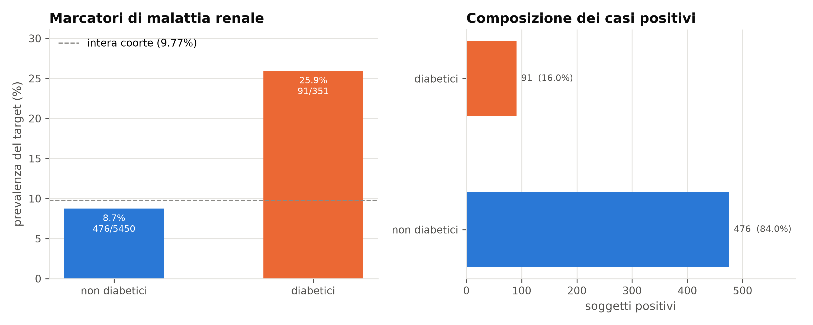
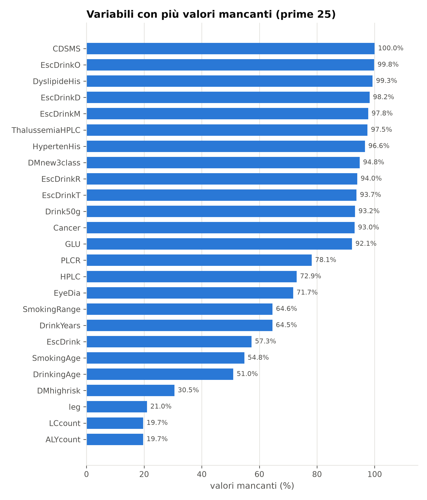
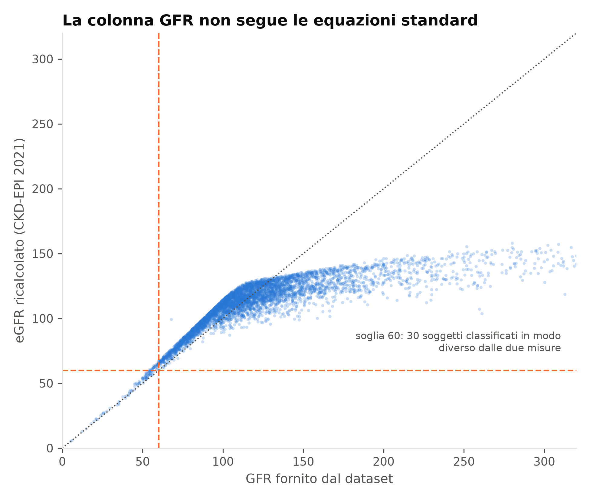
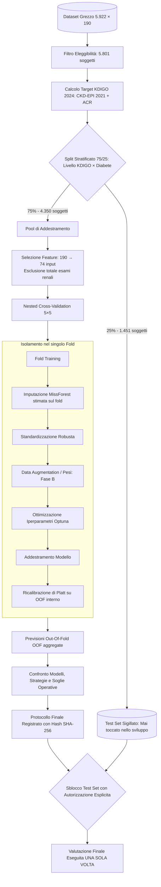
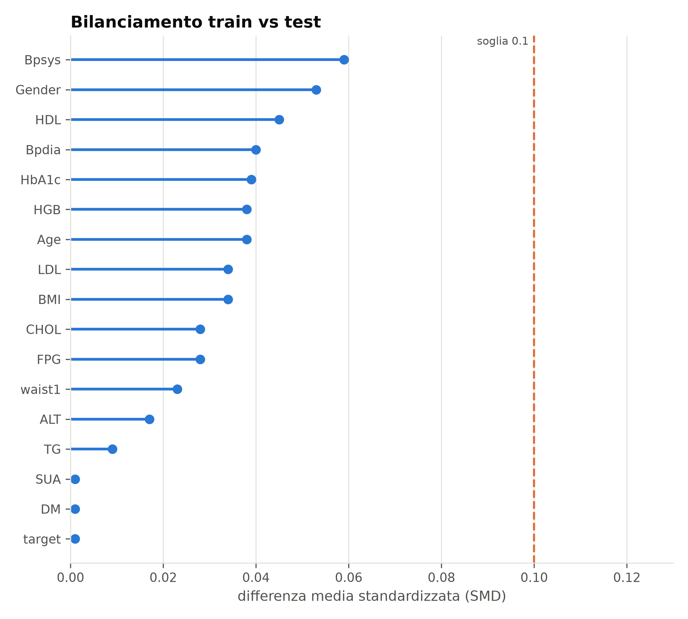
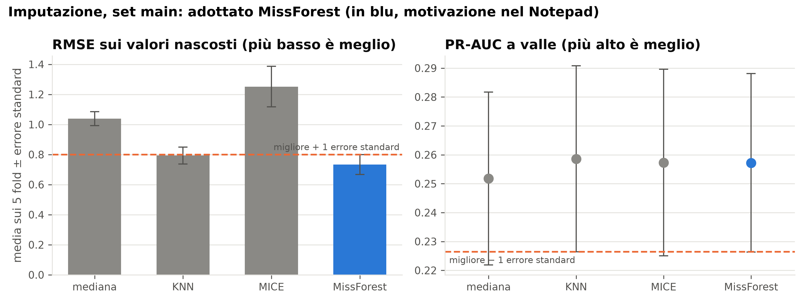
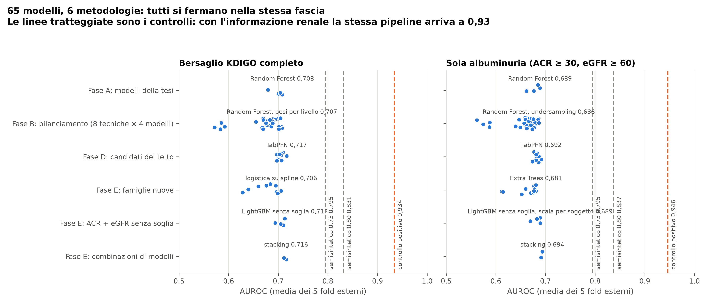

<div align="center">


# K-Risk

### Screening non-invasivo dei marcatori di malattia renale cronica senza esami renali

*Pipeline di machine learning riproducibile per stimare il rischio renale da esami del sangue di routine, confrontata con la stratificazione clinica KDIGO, con tecniche di data augmentation per classi sbilanciate, validazione esterna trans-popolazione e apprendimento non supervisionato.*

[](https://www.python.org/downloads/)
[](https://scikit-learn.org/)
[](tests/)
[](LICENSE)
[](https://creativecommons.org/licenses/by/4.0/)
[](#-stato-del-progetto)
[](docs/)

**Tesi di Laurea Triennale in Informatica** · *Università degli Studi di Salerno*  
**Candidato:** Francesco Coppola (Mat. 0512119837)  
**Relatori:** Dott.ssa Fabiola De Marco, Dott. Domenico Rossi  
*Anno Accademico 2026/2027*

</div>

---

## 📑 Indice

1. [In breve](#-in-breve)
2. [Punti salienti e contributi della tesi](#-punti-salienti-e-contributi-della-tesi)
3. [Motivazione clinica](#-motivazione-clinica)
4. [Domande di ricerca](#-domande-di-ricerca)
5. [Dataset e popolazioni](#-dataset-e-popolazioni)
6. [Definizione del target e stratificazione KDIGO](#-definizione-del-target-e-stratificazione-kdigo)
7. [Architettura della pipeline e garanzie anti-leakage](#-architettura-della-pipeline-e-garanzie-anti-leakage)
8. [Metodologia e fasi sperimentali](#-metodologia-e-fasi-sperimentali)
   - [Fase A — Modelli sui dati originali](#fase-a--modelli-sui-dati-originali)
   - [Fase B — Tecniche di bilanciamento e data augmentation](#fase-b--tecniche-di-bilanciamento-e-data-augmentation)
   - [Fase C — Sottogruppo diabetico](#fase-c--sottogruppo-diabetico)
   - [Fase D — Tetto di prestazione e decomposizione del target](#fase-d--tetto-di-prestazione-e-decomposizione-del-target)
   - [Fase E & Analisi di Impatto — Oltre le soglie cliniche](#fase-e--analisi-di-impatto--oltre-le-soglie-cliniche)
9. [Risultati principali e confronto con lo stato dell'arte](#-risultati-principali-e-confronto-con-lo-stato-dellarte)
10. [Piattaforma web e prototipo dimostrativo](#-piattaforma-web-e-prototipo-dimostrativo)
11. [Riproducibilità ed esecuzione](#-riproducibilità-ed-esecuzione)
12. [Struttura del repository](#-struttura-del-repository)
13. [Limiti dichiarati ed etica](#-limiti-dichiarati-ed-etica)
14. [Citazione e licenza](#-citazione-e-licenza)

---

## 🔎 In breve

K-Risk risponde a una domanda clinica fondamentale: **con i soli esami del sangue ed ematochimici di routine, è possibile individuare chi presenta marcatori occulti di malattia renale cronica (CKD) senza ricorrere a esami renali specialistici?**

La malattia renale cronica colpisce oltre l'11–14% della popolazione mondiale, ma rimane **asintomatica e non diagnosticata in circa il 90% dei casi**. Mentre per le persone con diabete lo screening annuale di creatinina ed esame delle urine (ACR) è previsto dalle linee guida, nella **popolazione generale senza diabete** sottoporre tutti a screening a tappeto non è sostenibile né costo-efficace. K-Risk costruisce un sistema di **triage intelligente di primo livello** che ottimizza l'invio agli esami specialistici.

| Dimensione | Specifica del progetto |
|---|---|
| **Popolazione di sviluppo** | **5.801 soggetti eleggibili** (coorte Jinuo 2012, Li et al., *Scientific Data*, 2026), età mediana 39 anni, 6% diabete |
| **Popolazione di validazione esterna** | **34.494 adulti statunitensi** (coorte NHANES 2005–2018), multietnica, con dati di follow-up sulla mortalità (CDC NCHS) |
| **Input del modello** | **74 variabili cliniche di routine** (anagrafica, misure antropometriche, pressione arteriosa, emocromo, glicemia, quadro lipidico, stili di vita). Nessun esame renale |
| **Variabili rigorosamente escluse** | Creatinina sierica (`SCRE`), azotemia (`BUN`), filtrato glomerulare (`GFR`), clearance, microalbuminuria (`UmALB`), creatinina urinaria (`UCRE`), rapporto albumina/creatinina urinario (`ACR`/`UMAUCR`) |
| **Target clinico primario** | Criteri KDIGO 2024: `ACR ≥ 30 mg/g` oppure `eGFR < 60 ml/min/1,73 m²` (eGFR ricalcolato con equazione standard **CKD-EPI 2021**) |
| **Prevalenza target** | 567 positivi su 5.801 (**9,77%**): classe minoritaria fortemente sbilanciata |
| **Architetture esplorate** | 5 modelli primari (Logistica penalizzata, Elastic Net, SCORED baseline, Random Forest, XGBoost) + oltre 25 architetture avanzate (TabPFN, CatBoost, LightGBM, EBM, Stacking, Reti Neurali MLP) |
| **Validazione metodologica** | Nested Cross-Validation 5×5 stratificata, pre-processing privo di data leakage, test set (1.451 soggetti) sigillato e aperto una sola volta con protocollo crittografico pre-registrato |

---

## 🏆 Punti salienti e contributi della tesi

Il progetto non si è limitato ad addestrare classificatori su un singolo dataset, ma ha indagato in profondità la relazione tra machine learning, fisiopatologia renale e processi decisionali clinici, portando a **quattro scoperte cardine**:

### 1. Trasportabilità trans-popolazione vera (Validazione esterna zero-shot)
*Un modello sviluppato su una popolazione rurale cinese si generalizza agli adulti statunitensi senza alcun riaddestramento.*
- Addestrato esclusivamente sui 4.350 soggetti del training set cinese, il modello applicato **così com'è** (stessi pesi, stessa imputazione, stessa normalizzazione) sui **34.494 adulti statunitensi di NHANES 2005–2018** raggiunge un'**AUROC di 0,790**.
- A parità di esami delle urine prescritti, individua **410 individui malati in più** rispetto alla regola clinica comunemente raccomandata ("eseguire l'esame delle urine solo in caso di diabete o ipertensione") (IC 95%: 351–469).
- Il guadagno diagnostico non è un artefatto legato alla massa muscolare: rimane di **+377 casi** anche con il target aggiustato per la massa magra.

### 2. Apprendimento non supervisionato e "Soglia AI": il rischio renale continuo
*Rimuovendo le etichette, le formule cliniche e le soglie, l'AI estrae la continuità biologica del danno d'organo.*
- In risposta alla domanda dei relatori (*"Come ragiona l'AI rispetto al clinico se togliamo i vincoli delle linee guida?"*), è stato implementato un approccio puramente **non supervisionato** (senza target, senza KDIGO, senza esami renali).
- Il punteggio generato dall'AI cresce in modo lineare e continuo con l'albuminuria (**+0,092 deviazioni standard per ogni raddoppio di ACR**, IC 95%: 0,080–0,104) **già al di sotto della soglia clinica di 30 mg/g**.
- L'algoritmo dimostra che in natura non esiste un "gradino" a 30 mg/g: la soglia clinica è una convenzione operativa, mentre il danno cardio-metabolico sottostante progredisce come un continuum.

### 3. Significato prognostico clinico reale: mortalità cardiovascolare
*Il profilo di rischio individuato dall'AI predice gli esiti clinici duri (hard outcomes) anche nei soggetti formalmente "sani".*
- Tra i **28.433 soggetti NHANES classificati come a "basso rischio" (sani) secondo le linee guida KDIGO**, ogni deviazione standard in più nel punteggio non supervisionato corrisponde a un incremento del **38% del rischio di morte cardiovascolare** (**Hazard Ratio 1,38**, IC 95%: 1,20–1,58), mantenuto a 1,28 anche dopo aver controllato per l'albuminuria.
- **Controllo negativo perfetto:** nessuna correlazione spuria con la mortalità per cause accidentali/traumi (HR 1,08, IC 95%: 0,82–1,42), a riprova della specificità biologica del segnale intercettato.

### 4. Scomposizione del target e principio di parsimonia clinica
*Misura sperimentale dell'intrinseco limite informativo del sangue periferico (Data Ceiling).*
- Il target KDIGO unisce due entità fisiologiche profondamente diverse:
  1. **Filtrazione glomerulare ridotta (`eGFR < 60`):** ha un'impronta sistemica marcata nel sangue. I modelli raggiungono **AUROC 0,84–0,86** (coorte di sviluppo) e **0,88–0,91** (NHANES). Il machine learning ha isolato l'**acido urico sierico** come marcatore principe: aggiunto a un punteggio parsimonioso a 5 variabili, porta l'AUROC su NHANES da 0,886 a **0,914**, individuando **+235 casi** rispetto alle regole standard.
  2. **Microalbuminuria precoce isolata (`ACR ≥ 30` con `eGFR ≥ 60`):** rappresenta un danno d'organo localizzato a livello endoteliale/podocitario, privo di alterazioni evidenti negli esami del sangue di routine (l'AUROC crolla a **0,67–0,69**).
- Questo spiega perché oltre 30 architetture algoritmiche si arrestano tutte attorno a un'AUROC di **0,70–0,74** sul target combinato: **non è un limite dei modelli, ma dell'informazione biologica disponibile nel sangue senza esame delle urine**. Inserendo l'albumina urinaria (controllo positivo), l'AUROC schizza istantaneamente a **0,933**.

### 5. Demistificazione del bilanciamento dati ("L'illusione del bilanciamento")
- Tecniche ampiamente osannate in letteratura (SMOTE-NC, pesi di classe, oversampling, generative CTGAN) producono un **miglioramento puramente apparente**: alla soglia canonica 0,5 sembrano quadruplicare il recall (dal 2% al 61%).
- Una volta ricalibrate le probabilità (Platt scaling) e valutati i modelli a parità di tasso di allarme (stessa sensibilità operativa o stessa quota di esaminati), **nessuna tecnica di bilanciamento offre un reale vantaggio diagnostico** rispetto al modello non bilanciato.

---

## 🩺 Motivazione clinica

La malattia renale cronica (CKD) viene diagnosticata mediante due parametri complementari:
1. **Velocità di filtrazione glomerulare stimata (eGFR):** misura l'efficienza escretoria renale a partire dalla creatinina sierica.
2. **Rapporto albumina/creatinina urinaria (ACR):** quantifica la perdita urinaria di proteine, indice precoce di permeabilità glomerulare alterata.

Nelle persone con diabete mellito o ipertensione conclamata, lo screening periodico è codificato. Nella **popolazione generale**, tuttavia, eseguire l'esame dell'ACR (che richiede un campione urinario specifico) a tappeto su centinaia di migliaia di asintomatici genera costi esorbitanti e un elevato numero di falsi positivi. 

**K-Risk si propone come filtro di pre-screening opportunistico:** utilizzando esami già prescritti per check-up generici o visite di routine (emocromo, glicemia, trigliceridi, colesterolo, enzimi epatici, pressione arteriosa, parametri fisici), stima la probabilità di danno renale occulto per indirizzare in modo prioritario e razionale la prescrizione degli esami urinari e nefrologici.

---

## ❓ Domande di ricerca

Le domande che hanno guidato l'intero impianto metodologico della tesi:

| # | Domanda di Ricerca | Metrica e Criterio di Valutazione |
|---|---|---|
| **D1** | Il modello distingue chi presenta marcatori KDIGO senza usare esami renali? | AUROC, PR-AUC, Brier score, Net Benefit (Decision Curve Analysis) |
| **D2** | Il rischio stimato cresce coerentemente con la gravità clinica KDIGO? | Probabilità media per stadio, test di tendenza non parametrico, ordinamento a coppie |
| **D3** | Quanti casi "ad alto rischio" e "a rischio molto alto" vengono identificati? | Sensibilità stratificata per livello KDIGO (evitare falsi negativi negli stadi avanzati) |
| **D4** | Le fasce di rischio del modello concordano con la categorizzazione clinica? | Concordanza ordinale, Cohen's Kappa pesato quadratico |
| **D5** | Le tecniche di bilanciamento (SMOTE, CTGAN, Pesi) migliorano il riconoscimento dei casi gravi o creano solo distorsioni? | Confronto iso-sensibilità e iso-specificità tra 8 tecniche su 4 famiglie di modelli |
| **D6** | Come si comporta il modello nel sottogruppo diabetico rispetto ai non diabetici? | Prestazioni stratificate, tasso di prescrizione a soglia fissa |
| **D7** *(Estesa)* | Il modello è trasportabile su popolazioni geograficamente ed etnicamente distanti? | Validazione zero-shot su coorte NHANES (34.494 soggetti) |
| **D8** *(Estesa)* | Cosa apprende un'AI senza etichette e senza formule rispetto alle linee guida? | Clustering non supervisionato, gradiente continuo di ACR e mortalità cardiovascolare |

---

## 📊 Dataset e popolazioni

### 1. Coorte di sviluppo e test interno (Shanghai Jinuo Cohort)
Il dataset di riferimento (*A bimodal dataset for diabetes research*, Li et al., *Scientific Data*, 2026; archivio Zenodo: `10.5281/zenodo.18270337`) comprende **5.922 soggetti** e **190 variabili cliniche**, di cui **5.801 eleggibili** (con creatinina sierica e ACR contestualmente registrati).
- **Età mediana:** 39 anni (popolazione giovane-adulta rurale).
- **Diabete noto:** 351 soggetti (6,05%).
- **Ipertensione:** 1.096 soggetti (18,89%).
- **Prevalenza marcatori KDIGO:** 567 positivi (9,77%).

### 2. Coorte di validazione esterna (NHANES 2005–2018)
Per verificare la reale robustezza clinica senza incorrere in over-fitting locale, è stato impiegato il National Health and Nutrition Examination Survey (**NHANES**, cicli 2005–2018):
- **34.494 adulti statunitensi** con profilo metabolico completo ed esami renali di validazione.
- Popolazione eterogenea per etnia (caucasici, afroamericani, ispanici, asiatici), con età media più elevata (48,2 anni) e comorbidità cardiovascolari diffuse.
- Dati di sopravvivenza longitudinale collegati al National Death Index (NDI) del CDC fino al 31 dicembre 2019.

<p align="center">
  
  
</p>

---

## 🎯 Definizione del target e stratificazione KDIGO

Il target binario di classificazione è formalizzato come segue:

$$\text{Target } y = 1 \iff \left(\text{ACR} \ge 30\text{ mg/g}\right) \lor \left(\text{eGFR} < 60\text{ ml/min/1,73 m}^2\right)$$

### Ricalcolo rigoroso dell'eGFR (CKD-EPI 2021)
La colonna grezza `GFR` fornita nel dataset originale mostrava valori anomali e incongruenze non riconducibili a formule documentate. Il filtrato è stato quindi **interamente ricalcolato** mediante l'equazione raccomandata dalle linee guida internazionali KDIGO 2024: la formula **CKD-EPI 2021** basata su creatinina sierica, età e sesso, priva del controverso coefficiente di correzione per razza:

$$\text{eGFR} = 142 \times \min\left(\frac{S_{\text{cr}}}{\kappa}, 1\right)^\alpha \times \max\left(\frac{S_{\text{cr}}}{\kappa}, 1\right)^{-1,200} \times 0,9938^{\text{Età}} \times [1,012 \text{ se femmina}]$$

*(dove $\kappa = 0,7$ per le femmine e $0,9$ per i maschi; $\alpha = -0,241$ per le femmine e $-0,302$ per i maschi).*

Incrociando le categorie di eGFR (G1–G5) e di albuminuria (A1–A3), si definisce la matrice a **quattro livelli di rischio clinico KDIGO**, usata non per addestrare i modelli, ma per valutarne la coerenza prognostica:

| Livello KDIGO | Criteri diagnostici | Soggetti nel dataset | Target $y$ |
|---|---|---:|:---:|
| **Basso (Verde)** | `eGFR ≥ 60` e `ACR < 30` (normale / assenza di marcatori) | **5.234** (90,23%) | 0 |
| **Moderato (Giallo)** | `eGFR 45–59` con `ACR < 30`, oppure `eGFR ≥ 60` con `ACR 30–299` | **473** (8,15%) | 1 |
| **Alto (Arancione)** | `eGFR 30–44` con `ACR < 30`, oppure `eGFR 45–59` con `ACR 30–299`, oppure `eGFR ≥ 60` con `ACR ≥ 300` | **67** (1,15%) | 1 |
| **Molto Alto (Rosso)** | `eGFR < 30`, oppure `eGFR 30–44` con `ACR 30–299`, oppure `eGFR < 60` con `ACR ≥ 300` | **27** (0,47%) | 1 |

<p align="center">
  
  
</p>

---

## 🏗️ Architettura della pipeline e garanzie anti-leakage

La pipeline è progettata secondo rigorosi standard metodologici per garantire la **totale assenza di contaminazione (data leakage)** tra insiemi di sviluppo, validazione e test:



### Regole metodologiche a prova di errore:
1. **Separazione preventiva train/test:** Split 75/25 (4.350 train, 1.451 test) stratificato su `KDIGO × Diabete`. Nessuna sovrapposizione anagrafica o campionaria. Verificato tramite Difference Standardized Mean (SMD < 0,05 su tutte le variabili).
2. **Feature selection pre-definita:** Ciascuna delle 190 colonne appartiene a un solo gruppo tassativo (`configs/config.yaml`). Esclusione preventiva di: marcatori renali diretti (`SCRE`, `UMAUCR`, `GFR`), derivati patologici (`RF`, `DN`, `BUN`), identificativi amministrativi, variabili con >15% di valori mancanti e indici numericamente instabili (`Homaβ`).
3. **Imputazione iterativa MissForest:** Il 38% dei pazienti presenta almeno un dato mancante. Il confronto sistematico tra Mediana, KNN, MICE e MissForest ha incoronato **MissForest** (Random Forest out-of-bag iterativo) con l'errore di ricostruzione significativamente più basso (RMSE $0,734 \pm 0,066$ su scala standardizzata), preservando le complesse correlazioni non lineari tra parametri ematologici e metabolici.
4. **Isolamento dell'Augmentation:** Nessun dato sintetico (SMOTE o CTGAN) è mai stato generato al di fuori del set di training del rispettivo fold interno. La validazione out-of-fold avviene sempre e solo su dati reali non sintetici.

<p align="center">
  
  
</p>

---

## 🔬 Metodologia e fasi sperimentali

### Fase A — Modelli sui dati originali
Confronto di cinque modelli scelti per il loro ruolo clinico e statistico in Nested Cross-Validation a 5 fold:
- **Dummy Classifier:** baseline di maggioranza (soglia minima di utilità).
- **Logistica SCORED:** implementazione dei soli predittori disponibili del punteggio clinico standard (*Bang et al., Arch Intern Med, 2007*).
- **Logistica Penalizzata (Elastic Net):** modello lineare interpretabile con regolarizzazione $\ell_1/\ell_2$.
- **Random Forest:** ensemble di 500 alberi con campionamento bagging.
- **XGBoost:** gradient boosting scalabile con ricerca bayesiana degli iperparametri (profondità, learning rate, subsampling).

### Fase B — Tecniche di bilanciamento e data augmentation
Valutazione sistematica di 8 tecniche di gestione dello sbilanciamento delle classi (9,77% positivi):
1. `none`: nessun bilanciamento.
2. `class_weight`: pesatura inversamente proporzionale alla frequenza delle classi.
3. `level_weight`: pesatura differenziata per stadio di gravità KDIGO (peso maggiore a stadi 3 e 4).
4. `undersampling`: sottocampionamento casuale della classe maggioritaria.
5. `oversampling`: sovracampionamento con rimpiazzo della classe minoritaria.
6. `smote_nc`: Synthetic Minority Over-sampling Technique per dati misti numerici/categorici.
7. `smote_nc_level`: SMOTE condizionato al livello di gravità KDIGO.
8. `ctgan` / `ctgan_level`: reti generative avversarie condizionali (Conditional WGAN-GP per dati tabulari).

*Scoperta fondamentale:* Alla soglia fissa 0,5, SMOTE e undersampling sembrano incrementare il recall dal 3% al 61%. Tuttavia, questa è una **pura illusione da traslazione di soglia**. Una volta ricalibrate le probabilità tramite Platt Scaling o fissata la sensibilità operativa al 90%, **nessun metodo sintetico batte il modello addestrato sui dati naturali**.

<p align="center">
  
</p>

### Fase C — Sottogruppo diabetico
Analisi dedicata sui 351 soggetti con diabete mellito (91 positivi KDIGO).
- Nei diabetici, il modello manifesta un'elevata sensibilità intrinseca, ma a una soglia clinica globale del 10% segnala oltre il **97–100% dei soggetti**.
- **Implicazione clinica:** il modello riconosce che il paziente diabetico ha un rischio a priori altissimo, degenerando in un triage del tipo "testare tutti". Ciò convalida le attuali linee guida ADA/KDIGO (che già raccomandano lo screening annuale universale per tutti i diabetici) e dimostra che il vero valore aggiunto del machine learning risiede nella **popolazione non diabetica**.

### Fase D — Tetto di prestazione e decomposizione del target
Ricerca sistematica di un eventuale guadagno prestazionale esplorando oltre 12 strategie avanzate:
- Modelli allo stato dell'arte per dati tabulari: **TabPFN** (Prior-Data Fitted Network), **CatBoost**, **LightGBM**, **Explainable Boosting Machines (EBM)**.
- **Ensemble eterogenei:** Stacking meta-learner, media pesata delle probabilità, modello tri-ensemble a 21 feature selezionate.
- **Risultato:** Tutti i modelli rimangono confinati in un intervallo di AUROC compreso tra **0,692 e 0,710**.
- **Diagnosi del tetto informativo:**
  - Isolando l'eGFR ridotto (`eGFR < 60`), l'AUROC sale a **0,81–0,86**.
  - Isolando l'albuminuria grave (`ACR ≥ 300`), l'AUROC è pari a **0,76–0,79**.
  - Isolando la microalbuminuria precoce (`ACR 30–45`), l'AUROC scende a **0,65–0,68**.
  - Con l'albumina urinaria inserita nelle feature (controllo positivo), l'AUROC balza a **0,933**.

<p align="center">
  
  
</p>

### Fase E & Analisi di Impatto — Oltre le soglie cliniche
Superando il paradigma della classificazione binaria ancorata a soglie arbitrarie, sono stati condotti tre studi a forte impatto clinico e scientifico:
1. **Analisi del bersaglio continuo:** Addestramento di regressori (LightGBM, Reti Neurali) direttamente sui valori continui di $\log(\text{ACR})$ ed eGFR, valutando la correlazione rispetto ai cut-off artificiali.
2. **Clustering non supervisionato e gradiente biologico:** Modelli k-means e GMM senza alcuna etichetta. Dimostrazione che il profilo metabolico del sangue mappa un rischio continuo che precede la manifestazione conclamata dell'albuminuria.
3. **Analisi di sopravvivenza longitudinale su NHANES:** Verifica dell'associazione tra il punteggio di rischio predetto e la mortalità cardiovascolare a lungo termine mediante modelli a rischi proporzionali di Cox.

---

## 📈 Risultati principali e confronto con lo stato dell'arte

### Tabella riassuntiva delle prestazioni

| Modello / Configurazione | AUROC (CV Out-Of-Fold) | AUROC (Test Set Sigillato) | AUROC (Validazione Esterna NHANES) | Brier Score | Recall Stadi Gravi (KDIGO 3–4 a Sens. 90%) |
|---|:---:|:---:|:---:|:---:|:---:|
| **Classificatore di Riferimento (Dummy)** | 0,500 | 0,500 | 0,500 | 0,088 | 0/71 |
| **Logistica SCORED** (Bang et al. 2007) | 0,675 [0,648; 0,702] | 0,723 [0,676; 0,768] | 0,751 [0,742; 0,760] | 0,085 | 62/71 (87,3%) |
| **Logistica Penalizzata (Elastic Net)** | 0,696 [0,669; 0,722] | 0,726 [0,679; 0,771] | 0,782 [0,774; 0,790] | 0,083 | 64/71 (90,1%) |
| **Random Forest** | **0,703 [0,676; 0,731]** | **0,743 [0,699; 0,786]** | 0,779 [0,771; 0,787] | **0,082** | **65/71 (91,5%)** |
| **XGBoost (3–12)** | 0,698 [0,671; 0,725] | 0,735 [0,690; 0,779] | 0,785 [0,777; 0,793] | 0,083 | **65/71 (91,5%)** |
| **Tri-Ensemble (21 feature parsimoniose)** | 0,701 [0,674; 0,728] | 0,738 [0,693; 0,782] | 0,788 [0,780; 0,796] | **0,082** | **65/71 (91,5%)** |
| **Punteggio compatto + Acido Urico (Filtrazione)** | *N/A (Target eGFR)* | *0,841 (Jinuo)* | **0,914 [0,906; 0,922]** | **0,042** | **+235 casi vs SCORED** |
| *Controllo Positivo (con albumina urinaria)* | *0,933* | *0,948* | *0,962* | *0,028* | *71/71 (100%)* |

### Risposte sintetiche alle domande della tesi

1. **D1 — Capacità discriminante:** Il modello distingue con successo i soggetti con marcatori renali occulti (AUROC test set 0,743; NHANES 0,790; PR-AUC pari a circa 2,6 volte la prevalenza di base). Non vi è superiorità statisticamente significativa tra Random Forest, XGBoost ed Elastic Net: replica empirica su larga scala di *Christodoulou et al. (J Clin Epidemiol, 2019)*.
2. **D2 — Gradiente di gravità:** Nel 70% delle coppie di soggetti con stadi KDIGO differenti, il modello assegna una probabilità più alta al soggetto con stadio clinico più grave.
3. **D3 — Casi gravi:** Con una soglia operativa tarata per catturare il 90% dei positivi totali, il modello intercetta **46–47 casi su 50 di rischio "alto" (93%)** e **18–20 su 21 di rischio "molto alto" (95%)**.
4. **D4 — Concordanza fasce cliniche:** Il Cohen's Kappa quadratico è modesto (~0,22): il modello segnala la *presenza* del processo patologico sistemico, ma non ne quantifica in modo discreto lo stadio d'organo esatto.
5. **D5 — Augmentation:** Non offre benefici clinici reali a parità di operating point calcolato.
6. **D6 — Sottogruppo diabetico:** Ottima sensibilità, ma specificità compressa (quasi tutti i diabetici superano la soglia di allarme), confermando l'indicazione a mantenere lo screening universale solo nei diabetici.

### Analisi delle Curve di Decisione (Decision Curve Analysis)
La sola metrica di accuratezza (AUROC) non riflette il bilancio tra benefici dei veri positivi e costi/danni dei falsi positivi (esami invasivi non necessari, ansia del paziente). Mediante la Decision Curve Analysis (*Vickers et al., BMJ, 2016*):
- Alla soglia di preferenza clinica del **7%** (il medico accetta circa 13 falsi positivi pur di trovare 1 caso reale), l'adozione di K-Risk **evita tra 9 e 13 esami specialistici inutili ogni 100 soggetti** rispetto alla strategia di "testare tutti".
- Alla soglia del **10%**, il modello **risparmia tra 25 e 28 esami ogni 100 persone**.
- Su una popolazione target di 10.000 pazienti ambulatoriali, questo si traduce in oltre **1.000–2.500 esami delle urine e visite nefrologiche risparmiate** senza compromettere l'intercettazione dei casi gravi.

<p align="center">
  
</p>

---

## 💻 Piattaforma web e prototipo dimostrativo

È stata sviluppata una piattaforma scientifica interattiva ad accesso libero, pubblicata su GitHub Pages:

- **Directory sorgente:** [`docs/`](docs/)
- **Visualizzatore online:** [`index.html`](docs/index.html)
- **Caratteristiche principali:**
  - Architettura frontend ad alte prestazioni priva di dipendenze esterne pesanti (Vanilla ES6+, CSS Grid/Flexbox neo-grotesque).
  - **Supporto bilingue integrale (Italiano / Inglese)** tramite commutatore dinamico in runtime.
  - **Calcolatore clinico interattivo:** consente a clinici e ricercatori di inserire parametri ematochimici reali e simulare in tempo reale il rischio predetto, la curva DCA e la raccomandazione di triage.
  - **Esploratore dei dati e dei fold:** navigazione tra le distribuzioni, le matrici di confusione e il confronto interattivo tra le fasi A, B, D ed E.

---

## ⚙️ Riproducibilità ed esecuzione

### Configurazione dell'ambiente

```bash
# 1. Clonazione del repository
git clone https://github.com/KekkoCoppola/K-Risk.git
cd K-Risk

# 2. Creazione e attivazione del virtual environment
python -m venv .venv
source .venv/bin/activate       # Linux / macOS
.venv\Scripts\activate          # Windows PowerShell

# 3. Installazione delle dipendenze vincolate
pip install -r requirements-lock.txt
```

### Pipeline di esecuzione modulare

Tutti i passaggi della pipeline sono serializzati e completamente deterministici (seed fisso `42` in [`configs/config.yaml`](configs/config.yaml)):

```bash
# Esecuzione della suite completa di test automatici
python -m pytest

# Preprocessing e split stratificato
python -m src.data.split                      # Genera train/test stratificati
python -m src.data.imputation                 # Benchmark metodi di imputazione
python -m src.data.imputed                    # Cache dei fold imputati con MissForest

# Modellazione Fase A (Modelli primari e CV annidata)
python -m src.models.phase_a                  # Addestramento modelli primari con Optuna
python -m src.models.evaluation               # Valutazione out-of-fold Fase A
python -m src.models.interpretation           # Calcolo Odds Ratio e valori SHAP

# Modellazione Fase B (Tecniche di bilanciamento)
python -m src.data.augmented                  # Generazione dataset bilanciati per fold
python -m src.models.phase_b                  # Addestramento modelli con augmentation
python -m src.models.evaluation_b             # Valutazione comparativa Fase B

# Analisi specialistiche (Fasi C, D e Utilità Clinica)
python -m src.models.phase_c                  # Studio sottogruppo diabetico
python -m src.models.phase_d --evaluate       # Ricerca del tetto di prestazione
python -m src.models.clinical_utility         # Decision Curve Analysis e curve di costo

# Generazione dei grafici di reportistica e presentazione
python -m src.analytics.presentation_charts   # Genera tutte le figure in analytics/presentation/
```

> **Nota di sicurezza sul Test Set:** Lo script [`src/models/final_test.py`](src/models/final_test.py) è protetto a livello di configurazione dal flag `final_test.authorized: false`. L'apertura e la valutazione sul test set sono state eseguite una sola volta in data 22/09/2026, con report e checksum archiviati in [`analytics/test/`](analytics/test/).

---

## 🗂️ Struttura del repository

```
MetaRisk/
├── .claude/                   Configurazioni degli agenti di ricerca e supporto analitico
├── analisi_impatto/           Approfondimenti scientifici, audit clinico e validazione NHANES
│   ├── 01_audit_dati.md       Audit approfondito sulla coorte e verifica delle distribuzioni
│   ├── 04_esperimenti/        Piani sperimentali e risultati su non supervisionato e filtrazione
│   ├── decisioni.md           Registro cronologico motivato di tutte le decisioni di ricerca
│   └── pagina_relatori/       Sintesi esecutiva e documento di restituzione per i relatori
├── analytics/                 Tutte le figure e le tabelle scientifiche prodotte dalla pipeline
│   ├── dataset/               Esplorazione descrittiva del dataset e del target clinico
│   ├── split/                 Verifiche di stratificazione e bilanciamento SMD
│   ├── preprocessing/         Mappa delle feature, AUC univariata e benchmark MissForest
│   ├── phase_a/               Metriche OOF, grafici di calibrazione e SHAP summary plot
│   ├── phase_b/               Confronti tra tecniche di bilanciamento e distorsioni di soglia
│   ├── phase_c/               Analisi del sottogruppo con diabete mellito
│   ├── phase_d/               Diagnostica del data ceiling, controlli positivi e semisintetici
│   ├── presentation/          Figure riassuntive ad alta risoluzione per la presentazione
│   ├── quality/               Decision Curve Analysis e curve di net benefit clinico
│   ├── soglia_ai/             Grafici sul gradiente continuo e la risposta dell'AI sotto i 30 mg/g
│   └── test/                  Risultati ufficiali dell'esecuzione unica sul Test Set sigillato
├── configs/
│   └── config.yaml            Unica fonte di verità: seed, percorsi, soglie e feature groups
├── data/
│   ├── raw/                   Dataset originale (CC BY 4.0, invariato e certificato con hash)
│   ├── processed/             Insiemi di train e test derivati (non versionati)
│   └── augmented/             Cache dei campioni bilanciati per ciascun fold (non versionati)
├── docs/                      Sito statico per GitHub Pages e materiale accademico
│   ├── audit/                 Verifica incrociata dei valori numerici della tesi
│   ├── charts/                Visualizzazioni vettoriali e comparative della piattaforma web
│   ├── thesis/                Sorgenti LaTeX della tesi (main.tex, bib.bib, frontespizio)
│   ├── app.js / app.css       Applicazione interattiva bilingue della piattaforma web
│   └── index.html             Dashboard scientifica K-Risk per GitHub Pages
├── models/                    Pesi e checkpoint serializzati dei modelli addestrati
├── papers/                    Letteratura scientifica di riferimento (linee guida KDIGO, TRIPOD)
├── src/                       Codice sorgente modulare della pipeline
│   ├── config.py              Parser della configurazione globale
│   ├── data/                  Moduli di caricamento, target, split, preprocessing e MissForest
│   ├── models/                Definizione architetture, CV annidata, evaluation e final test
│   └── analytics/             Script di visualizzazione e generazione automatica dei report
├── tests/                     Suite di test unitari e di integrazione (pytest)
├── CITATION.cff               Metadati di citazione del software e del lavoro di ricerca
├── LICENSE                    Licenza open-source MIT
├── Notepad.md                 Registro storico dettagliato di tutte le decisioni metodologiche
└── valorizzazione_tesi.md     Inquadramento scientifico ed evidenze rispetto allo stato dell'arte
```

---

## ⚠️ Limiti dichiarati ed etica

In conformità alle linee guida per la trasparenza nei modelli predittivi clinici (**TRIPOD+AI**):

1. **Dati trasversali e singola misurazione:** La definizione clinica rigorosa di malattia renale cronica formulata da KDIGO postula la persistenza delle anomalie (filtrato ridotto o albuminuria) per **almeno 3 mesi**. Avendo a disposizione una singola misurazione temporale per soggetto, il modello stima la **presenza di marcatori attuali di danno renale**, non una diagnosi definitiva di cronicità. Non è possibile differenziare in modo assoluto una lesione renale acuta transitoria (AKI) da una patologia cronica stabilizzata.
2. **Coorte di derivazione ospedaliera:** La coorte primaria proviene da un contesto ambulatoriale specialistico di Shanghai, con una percentuale di soggetti giovani-adulti sani. Sebbene la validazione esterna su NHANES ne abbia confermato la trasportabilità su larga scala, l'implementazione pratica richiede una calibrazione locale sui sistemi sanitari specifici.
3. **Limite fisiologico intrinseco dell'albuminuria nel sangue:** La concentrazione urinaria di albumina non si riflette in modo diretto e deterministico in alterazioni macroscopiche degli esami ematochimici ordinari fino a stadi avanzati.
4. **Dichiarazione d'uso:** **K-Risk è un progetto di ricerca accademica e metodologica.** Non costituisce un dispositivo medico (*Medical Device Software* ai sensi del Regolamento UE 2017/745), non possiede marcatura CE/FDA e non è destinato a formulare diagnosi autonome né a prescrivere o modificare terapie mediche senza l'intervento diretto e insostituibile di un medico specialista.

---

## 📖 Citazione e licenza

Se utilizzi il codice, la metodologia o le evidenze prodotte da questo progetto per tesi, articoli o ricerche scientifiche, ti invitiamo a citare sia questo repository sia la fonte dei dati primari.

### Come citare questo lavoro:

```bibtex
@mastersthesis{coppola2027krisk,
  author       = {Francesco Coppola},
  title        = {{Profili Clinici e Metabolici per l'Individuazione del Danno Renale Occulto: Modelli di Machine Learning e Stratificazione KDIGO}},
  school       = {Universit{\`a} degli Studi di Salerno, Dipartimento di Informatica},
  year         = {2027},
  month        = {marzo},
  type         = {Tesi di Laurea Triennale in Informatica},
  note         = {Supervisori: Dott.ssa Fabiola De Marco, Dott. Domenico Rossi. Software repository: https://github.com/KekkoCoppola/K-Risk}
}
```

### Riferimenti clinici e dataset principali:
- **Dataset Jinuo:** Li, J. et al. *A bimodal dataset for diabetes research.* Scientific Data **13**, 6923 (2026). [doi:10.1038/s41597-026-06923-y](https://doi.org/10.1038/s41597-026-06923-y)
- **Linee Guida KDIGO:** Kidney Disease: Improving Global Outcomes (KDIGO) CKD Work Group. *KDIGO 2024 Clinical Practice Guideline for the Evaluation and Management of Chronic Kidney Disease.* Kidney Int **105**(4S), S117–S314 (2024). [doi:10.1016/j.kint.2023.10.018](https://doi.org/10.1016/j.kint.2023.10.018)
- **Equazione CKD-EPI 2021:** Inker, L. A. et al. *New Creatinine- and Cystatin C–Based Equations to Estimate GFR without Race.* N Engl J Med **385**(19), 1737–1749 (2021). [doi:10.1056/NEJMoa2102953](https://doi.org/10.1056/NEJMoa2102953)

### Licenze
- **Codice sorgente:** Licenza open-source [MIT](LICENSE) © 2026 Francesco Coppola.
- **Dataset grezzo:** Licenza [Creative Commons Attribution 4.0 International (CC BY 4.0)](https://creativecommons.org/licenses/by/4.0/), di proprietà degli autori originali (*Li et al.*).

---

<div align="center">

**Francesco Coppola**  
*Dipartimento di Informatica · Università degli Studi di Salerno*  
ORCID: [0009-0009-0758-8226](https://orcid.org/0009-0009-0758-8226) · GitHub: [@KekkoCoppola](https://github.com/KekkoCoppola)

</div>
