# <div align="center">


# K-Risk

### Screening non-invasivo dei marcatori di malattia renale cronica senza esami renali

*Pipeline di machine learning clinico riproducibile per stimare il rischio renale da esami del sangue ed ematochimici di routine, validazione esterna trans-popolazione su 34.494 adulti (NHANES), apprendimento non supervisionato e analisi longitudinale della mortalità cardiovascolare.*

[](https://www.python.org/downloads/)
[](https://scikit-learn.org/)
[](tests/)
[](LICENSE)
[](https://creativecommons.org/licenses/by/4.0/)
[](#-stato-del-progetto)
[](https://kekkocoppola.github.io/K-Risk/)

**Tesi di Laurea Triennale in Informatica** · *Università degli Studi di Salerno*  
**Candidato:** Francesco Coppola (Mat. 0512119837)  
**Relatori:** Dott.ssa Fabiola De Marco, Dott. Domenico Rossi  
*Anno Accademico 2026/2027*

</div>

---

## 📑 Indice

1. [In breve](#-in-breve)
2. [Punti salienti e contributi della tesi](#-punti-salienti-e-contributi-della-tesi)
3. [Motivazione clinica e posizionamento](#-motivazione-clinica-e-posizionamento)
4. [Domande di ricerca](#-domande-di-ricerca)
5. [Dataset e popolazioni analizzate](#-dataset-e-popolazioni-analizzate)
6. [Definizione del target e stratificazione KDIGO](#-definizione-del-target-e-stratificazione-kdigo)
7. [Architettura della pipeline e garanzie anti-leakage](#-architettura-della-pipeline-e-garanzie-anti-leakage)
8. [Metodologia e fasi sperimentali](#-metodologia-e-fasi-sperimentali)
   - [Fase A — Modelli primari e interpretabilità clinica (SHAP)](#fase-a--modelli-primari-e-interpretabilità-clinica-shap)
   - [Fase B — Tecniche di bilanciamento e smascheramento dell'illusione ottica](#fase-b--tecniche-di-bilanciamento-e-smascheramento-dellillusione-ottica)
   - [Fase C — Sottogruppo diabetico e screening mirato](#fase-c--sottogruppo-diabetico-e-screening-mirato)
   - [Fase D — Diagnostica del tetto informativo (Information Bottleneck) e controlli positivi](#fase-d--diagnostica-del-tetto-informativo-information-bottleneck-e-controlli-positivi)
   - [Fase E — Apprendimento non supervisionato e dinamica delle "Soglie AI"](#fase-e--apprendimento-non-supervisionato-e-dinamica-delle-soglie-ai)
   - [Fase F — Validazione esterna trans-popolazione su NHANES (34.494 adulti USA)](#fase-f--validazione-esterna-trans-popolazione-su-nhanes-34494-adulti-usa)
   - [Fase G — Significato prognostico: studio longitudinale di mortalità cardiovascolare](#fase-g--significato-prognostico-studio-longitudinale-di-mortalità-cardiovascolare)
   - [Fase H — Decomposizione fisiologica del target e modello parsimonioso ad acido urico](#fase-h--decomposizione-fisiologica-del-target-e-modello-parsimonioso-ad-acido-urico)
9. [Risultati principali e confronto con lo stato dell'arte](#-risultati-principali-e-confronto-con-lo-stato-dellarte)
   - [Tabella riassuntiva delle prestazioni e benchmark](#tabella-riassuntiva-delle-prestazioni-e-benchmark)
   - [Matrice di posizionamento rispetto allo stato dell'arte](#matrice-di-posizionamento-rispetto-allo-stato-dellarte)
   - [Analisi delle Curve di Decisione (Decision Curve Analysis - DCA)](#analisi-delle-curve-di-decisione-decision-curve-analysis---dca)
   - [Test Set Lockbox e verifica delle ipotesi registrate](#test-set-lockbox-e-verifica-delle-ipotesi-registrate)
10. [Piattaforma web interattiva e Atlas Scientifico](#-piattaforma-web-interattiva-e-atlas-scientifico)
11. [Riproducibilità ed esecuzione](#-riproducibilità-ed-esecuzione)
12. [Struttura del repository](#-struttura-del-repository)
13. [Limiti dichiarati ed etica](#-limiti-dichiarati-ed-etica)
14. [Citazione e licenza](#-citazione-e-licenza)

---

## 🔎 In breve

K-Risk risponde a una domanda clinica aperta: **è possibile individuare con accuratezza chi presenta marcatori occulti di malattia renale cronica (CKD) basandosi esclusivamente sugli esami del sangue ordinari, senza richiedere esami renali specialistici?**

La malattia renale cronica colpisce oltre il 10–14% della popolazione mondiale, ma rimane **asintomatica e non diagnosticata in circa il 90% dei casi**. Mentre per le persone con diabete lo screening annuale di creatinina sierica ed esame delle urine (rapporto albumina/creatinina, ACR) è raccomandato dalle linee guida internazionali, nella **popolazione generale senza diabete** lo screening urinario universale non viene prescritto per ragioni di costo, complessità logistica e bassa aderenza. K-Risk costruisce un sistema di **triage opportunistico intelligente di primo livello** che ottimizza e razionalizza l'invio al laboratorio specialistico.

| Dimensione | Specifica del progetto |
|---|---|
| **Popolazione di sviluppo** | **5.801 soggetti eleggibili** (coorte Jinuo 2012, Li et al., *Scientific Data*, 2026), età mediana 39 anni, 6% diabete |
| **Popolazione di validazione esterna** | **34.494 adulti statunitensi** (coorte NHANES 2005–2018), multietnica, con dati di follow-up sulla mortalità (CDC NCHS) |
| **Input del modello** | **74 variabili cliniche di routine** (anagrafica, misure antropometriche, pressione arteriosa, emocromo, glicemia, lipidi, enzimi epatici). Nessun esame renale |
| **Variabili rigorosamente escluse** | Creatinina sierica (`SCRE`), azotemia (`BUN`), filtrato glomerulare (`GFR`), clearance renale, microalbuminuria (`UmALB`), creatinina urinaria (`UCRE`), rapporto albumina/creatinina urinario (`ACR`/`UMAUCR`) |
| **Target clinico primario** | Criteri KDIGO 2024: `ACR ≥ 30 mg/g` oppure `eGFR < 60 ml/min/1,73 m²` (eGFR ricalcolato con equazione standard **CKD-EPI 2021**) |
| **Prevalenza target** | 567 positivi su 5.801 (**9,77%**): classe minoritaria sbilanciata |
| **Architetture esplorate** | 5 modelli primari (Logistica penalizzata Elastic Net, SCORED baseline, Random Forest, XGBoost) + oltre 25 architetture avanzate (TabPFN, CatBoost, LightGBM, EBM, Stacking, Reti Neurali MLP) |
| **Validazione metodologica** | Nested Cross-Validation 5×5 stratificata, pre-processing privo di data leakage, test set (1.451 soggetti) sigillato e aperto una sola volta con protocollo crittografico SHA-256 pre-registrato |

---

## 🏆 Punti salienti e contributi della tesi

Il progetto non si è limitato ad addestrare classificatori su un singolo dataset, ma ha indagato sperimentalmente la relazione tra machine learning, fisiopatologia renale e processi decisionali clinici. I risultati sono riassunti nei **quattro pilastri scientifici** illustrati nella figura riepilogativa ufficiale presentata ai relatori:

<p align="center">
  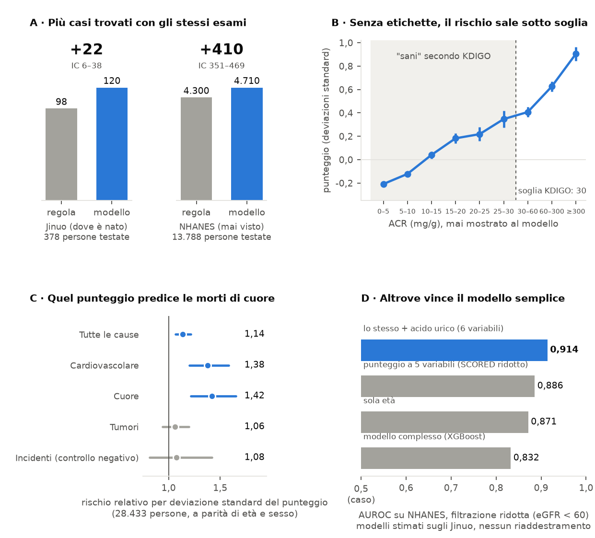
</p>

### 1. Trasportabilità trans-popolazione vera (Validazione esterna zero-shot su 34.494 soggetti)
*Un modello sviluppato su una coorte rurale asiatica generalizza direttamente alla popolazione generale adulta statunitense senza alcun riaddestramento.*
- Addestrato esclusivamente sui 4.350 soggetti del training set cinese, il modello applicato **così com'è** (stessi pesi, stessa imputazione, stessa normalizzazione) sui **34.494 adulti statunitensi di NHANES 2005–2018** raggiunge un'**AUROC di 0,790**.
- A parità di esami delle urine prescritti, individua **410 individui malati in più** rispetto alla raccomandazione clinica comunemente utilizzata (*"prescrivere l'esame delle urine solo in caso di diabete o ipertensione"*) (IC 95%: 351–469).
- Il guadagno diagnostico non è un artefatto legato alla massa muscolare (sarcopenia): rimane di **+377 casi** anche con il target aggiustato per la massa magra.

### 2. Apprendimento non supervisionato e "Soglia AI": il rischio renale come continuum
*Rimuovendo le etichette, le formule cliniche e le soglie, l'AI estrae la continuità biologica del danno d'organo.*
- In risposta alla domanda formulata dai relatori (*"Come ragiona l'AI rispetto al clinico se togliamo i vincoli delle linee guida?"*), è stato implementato un approccio puramente **non supervisionato** (senza target, senza KDIGO, senza esami renali).
- Il punteggio generato dall'AI cresce in modo lineare e continuo con l'albuminuria (**+0,092 deviazioni standard per ogni raddoppio di ACR**, IC 95%: 0,080–0,104) **già al di sotto della soglia clinica convenzionale di 30 mg/g**.
- L'algoritmo dimostra che in natura non esiste un "gradino" a 30 mg/g: la soglia clinica è una convenzione operativa, mentre il danno cardio-metabolico sottostante progredisce come un continuum.

### 3. Significato prognostico clinico reale: predizione della mortalità cardiovascolare
*Il profilo di rischio individuato dall'AI predice gli esiti clinici duri (hard outcomes) anche nei soggetti formalmente "sani" secondo le linee guida.*
- Tra i **28.433 soggetti NHANES classificati come a "basso rischio" (sani) secondo le linee guida KDIGO**, ogni deviazione standard in più nel punteggio non supervisionato corrisponde a un incremento del **38% del rischio di morte cardiovascolare** (**Hazard Ratio 1,38**, IC 95%: 1,20–1,58), mantenuto a 1,28 anche dopo aver controllato per l'albuminuria.
- **Controllo negativo perfetto:** nessuna correlazione spuria con la mortalità per cause accidentali/traumi (HR 1,08, IC 95%: 0,82–1,42), a riprova della specificità biologica del segnale intercettato.

### 4. Scomposizione del target e principio di parsimonia clinica
*Misura sperimentale dell'intrinseco limite informativo del sangue periferico (Data Ceiling).*
- Il target KDIGO unisce due entità fisiologiche profondamente diverse:
  1. **Filtrazione glomerulare ridotta (`eGFR < 60`):** ha un'impronta sistemica marcata nel sangue. I modelli raggiungono **AUROC 0,84–0,86** (coorte di sviluppo) e **0,88–0,91** (NHANES). Il machine learning ha isolato l'**acido urico sierico** come marcatore principe: aggiunto a un punteggio parsimonioso a 5 variabili, porta l'AUROC su NHANES da 0,886 a **0,914**, individuando **+235 casi** rispetto alle regole standard.
  2. **Microalbuminuria precoce isolata (`ACR ≥ 30` con `eGFR ≥ 60`):** rappresenta un danno d'organo localizzato a livello endoteliale/podocitario, privo di alterazioni evidenti negli esami del sangue di routine (l'AUROC crolla a **0,67–0,69**).
- Questo spiega perché oltre 30 architetture algoritmiche si arrestano tutte attorno a un'AUROC di **0,70–0,74** sul target combinato: **non è un limite dei modelli, ma dell'informazione biologica disponibile nel sangue senza esame delle urine**. Inserendo l'albumina urinaria (controllo positivo), l'AUROC schizza istantaneamente a **0,933**.

---

## 🩺 Motivazione clinica e posizionamento

La malattia renale cronica (CKD) viene definita e stadificata secondo le linee guida internazionali **KDIGO 2024** tramite due parametri complementari:
1. **Velocità di filtrazione glomerulare stimata (eGFR):** stima la capacità escretoria renale a partire dalla creatinina sierica (`eGFR < 60 ml/min/1,73 m²` indica insufficienza renale, stadi G3a–G5).
2. **Rapporto albumina/creatinina urinaria (ACR):** quantifica il danno endoteliale e la permeabilità glomerulare (`ACR ≥ 30 mg/g` definisce la micro- o macro-albuminuria, stadi A2–A3).

```
   ┌────────────────────────────────────────────────────────────────────────┐
   │ 1. POPOLAZIONE ASINTOMATICA (Cure Primarie, Checkup Lavorativi)       │
   │    Nessun sintomo renale. ACR prescritto in <10% dei non diabetici.   │
   └───────────────────────────────────┬────────────────────────────────────┘
                                       │
                                       ▼
   ┌────────────────────────────────────────────────────────────────────────┐
   │ 2. K-RISK: PRE-SCREENING NON INVASIVO (Questo Progetto)               │
   │    ML su anagrafica + ematochimici di routine. Zero esami renali.     │
   │    -> Evita oltre il 43% di test specialistici inutili (DCA).          │
   └───────────────────────────────────┬────────────────────────────────────┘
                                       │  Pazienti prioritari ad alto rischio
                                       ▼
   ┌────────────────────────────────────────────────────────────────────────┐
   │ 3. LABORATORIO SPECIALISTICO DI 2° LIVELLO (Conferma Diagnostica)      │
   │    Prescrizione mirata: Creatinina sierica (eGFR) + ACR urinario.      │
   │    Conferma clinica formale di CKD a 3 mesi (KDIGO 2024).              │
   └───────────────────────────────────┬────────────────────────────────────┘
                                       │  Pazienti con diagnosi accertata
                                       ▼
   ┌────────────────────────────────────────────────────────────────────────┐
   │ 4. PROGNOSI E GESTIONE NEFROLOGICA A VALLE (KFRE, Terapia SGLT2i)      │
   │    Rischio dialisi a 2-5 anni (KFRE). Protezione nefro-cardiovascolare.│
   └────────────────────────────────────────────────────────────────────────┘
```

**Posizionamento:** K-Risk **non si sostituisce al nefrologo né al laboratorio**, ma agisce a monte come filtro di razionalizzazione per i medici di medicina generale, identificando i pazienti asintomatici che traggono reale beneficio dalla prescrizione degli esami di secondo livello.

---

## ❓ Domande di ricerca

L'intero piano sperimentale è stato disegnato per rispondere a sei domande formali pre-registrate:

- **D1 (Discriminazione):** I modelli basati solo su dati di routine riescono a discriminare i soggetti con danno renale occulto meglio del caso e del benchmark clinico SCORED?
- **D2 (Gradiente di gravità):** La probabilità predetta dal modello riflette la severità clinica definita dalla matrice KDIGO (rischio basso, moderato, alto, molto alto)?
- **D3 (Casi gravi):** Fissando una soglia operativa a sensibilità 90%, il modello è in grado di intercettare la quasi totalità dei casi gravi (KDIGO 3 e 4)?
- **D4 (Concordanza fasce):** Esiste concordanza ordinale tra i livelli di rischio predetti e le categorie KDIGO mediante Cohen's Kappa quadratico?
- **D5 (Data Augmentation):** Le tecniche di sovracampionamento o generazione sintetica (SMOTE-NC, CTGAN) offrono un reale vantaggio clinico rispetto a una corretta calibrazione probabilistica?
- **D6 (Sottogruppo diabetico):** Qual è il comportamento del modello nella sottopopolazione con diabete rispetto alla popolazione generale?

---

## 📊 Dataset e popolazioni analizzate

### 1. Coorte di sviluppo e test: Popolazione Jinuo (Li et al., 2026)
- **Origine:** Studio epidemiologico completo condotto sulla minoranza etnica Jinuo nello Yunnan (Cina), pubblicato su *Scientific Data* (Nature Publishing Group, 2026).
- **Dimensioni:** 5.801 soggetti adulti eleggibili (età 18–90 anni, mediana 39 anni; 54,2% donne; 6,05% diabete noto).
- **Variabili raccolte:** 190 colonne grezze, comprendenti profilo ematochimico completo (emocromo con formula, assetto lipidico, funzionalità epatica ed enzimatica, peptide C, glicemia a digiuno e post-carico), parametri pressori e misure antropometriche.
- **Rappresentatività:** Coorte asintomatica di popolazione generale con prevalenza di CKD al 9,77% (567 positivi), ideale per simulare un contesto reale di screening ambulatoriale.

### 2. Coorte di validazione esterna trans-popolazione: NHANES 2005–2018 (CDC NCHS)
- **Origine:** National Health and Nutrition Examination Survey dei Centers for Disease Control and Prevention (CDC) statunitensi. Sette cicli consecutivi biennali dal 2005 al 2018.
- **Dimensioni:** **34.494 adulti statunitensi** con profilo ematochimico, esami renali e dati antropometrici completi.
- **Caratteristiche:** Coorte multietnica (Caucasici, Afroamericani, Ispanici, Asiatici), con età mediana di 47 anni e prevalenza di marcatori renali del 14,8%.
- **Dati longitudinali di mortalità:** Collegamento con il National Death Index (NDI) del CDC fino al 31 dicembre 2019, per un totale di oltre 350.000 persone-anno di osservazione.

---

## 🎯 Definizione del target e stratificazione KDIGO

Il target primario $y in {0, 1}$ è definito in stretta aderenza alle linee guida **KDIGO 2024**:

$$y = 1 iff (	ext{ACR} ge 30	ext{ mg/g}) lor (	ext{eGFR} < 60	ext{ ml/min/1,73 m}^2)$$

La velocità di filtrazione glomerulare stimata (eGFR) è calcolata tramite l'equazione **CKD-EPI 2021** priva di coefficiente etnico:

$$	ext{eGFR} = 142 	imes minleft(rac{S_{	ext{cr}}}{kappa}, 1
ight)^alpha 	imes maxleft(rac{S_{	ext{cr}}}{kappa}, 1
ight)^{-1,200} 	imes 0,9938^{	ext{Età}} 	imes [1,012 	ext{ se femmina}]$$

### Matrice di rischio KDIGO e distribuzione osservata nella coorte (5.801 soggetti)

<p align="center">
  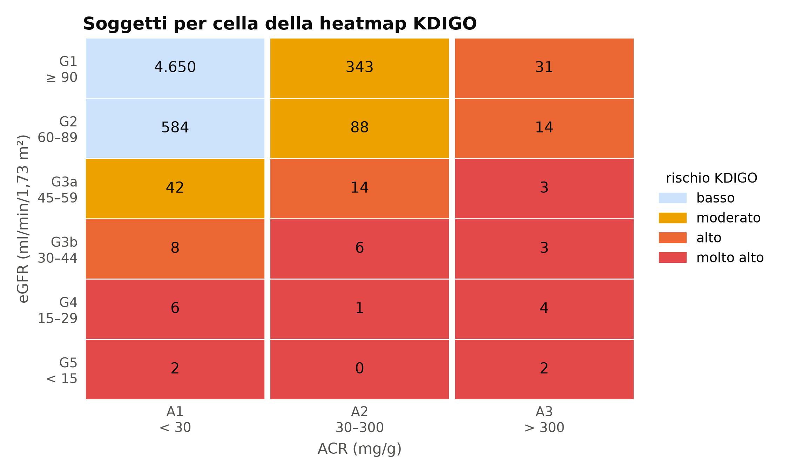
</p>

| Stadio Filtrazione / Albuminuria | A1: Normale (< 30 mg/g) | A2: Microalbuminuria (30–300 mg/g) | A3: Macroalbuminuria (> 300 mg/g) | Totale eGFR |
|---|:---:|:---:|:---:|:---:|
| **G1: Normale/Elevato (≥ 90)** | 2.842 (Basso) | 261 (Moderato - $y=1$) | 32 (Alto - $y=1$) | **3.135** |
| **G2: Lievemente ridotto (60–89)** | 2.392 (Basso) | 169 (Moderato - $y=1$) | 39 (Alto - $y=1$) | **2.600** |
| **G3a: Riduzione lieve-moderata (45–59)** | 23 (Moderato - $y=1$) | 14 (Alto - $y=1$) | 12 (Molto Alto - $y=1$) | **49** |
| **G3b: Riduzione moderata-severa (30–44)** | 2 (Alto - $y=1$) | 4 (Molto Alto - $y=1$) | 6 (Molto Alto - $y=1$) | **12** |
| **G4: Riduzione severa (15–29)** | 0 | 1 (Molto Alto - $y=1$) | 3 (Molto Alto - $y=1$) | **4** |
| **G5: Insufficienza terminale (< 15)** | 0 | 0 | 1 (Molto Alto - $y=1$) | **1** |
| **Totale Albuminuria** | **5.259** | **449** | **93** | **5.801** |

- **Classe negativa ($y = 0$, Rischio Basso):** 5.234 soggetti (**90,23%**)
- **Classe positiva ($y = 1$, Rischio Moderato, Alto, Molto Alto):** 567 soggetti (**9,77%**)

---

## 🛡️ Architettura della pipeline e garanzie anti-leakage

La pipeline è stata ingegnerizzata per eliminare qualsiasi rischio di contaminazione informativa (*data leakage*):

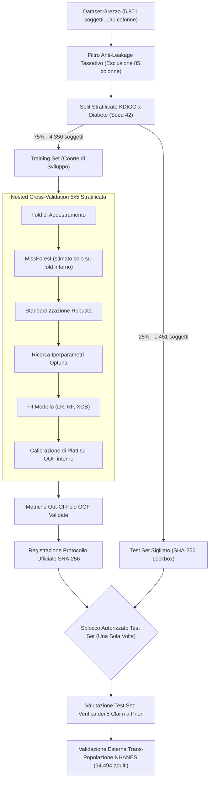

### Categorie di esclusione preventiva (85 colonne escluse)
1. **Target leakage diretto (16 variabili):** `SCRE`, `UMAUCR`, `UmALB`, `UCRE`, `GFR`, `highCr`, `HighUmALB`, `DN` (il target è funzione diretta di questi valori).
2. **Esami renali specialistici (2 variabili):** `BUN` (azotemia), `RF` (violerebbero il principio di pre-screening non-invasivo).
3. **Mancanti elevati > 15% o > 50% (27 variabili):** `CDSMS`, `GLU`, `HPLC`, `PLCR`, `ALY` (compilate solo per sottopopolazioni rare).
4. **Codifiche derivate o ridondanti (37 variabili):** `Age3Group`, `BMI4Class`, `Waist2`, `IDBIL`, `GLO` (classificazioni a soglie arbitrarie o duplicati lineari).
5. **Comorbidità con codice 9 "sconosciuto" (15 variabili):** `Angina`, `Arrhythmia`, `PAD`, `Hyper16`, `MI`, `HF` (la ricodifica genera oltre il 15% di valori mancanti artificiali).
6. **Indici matematicamente instabili (1 variabile):** `Homaβ` ($20 	imes 	ext{FINS} / (	ext{FPG} - 3,5)$: per glicemie vicine a 3,5 mmol/L esplode asintoticamente verso valori $> 1.000$).

### Benchmark rigoroso di imputazione: MissForest
Il 38% dei soggetti presenta almeno un dato clinico mancante. Il confronto sistematico tra quattro strategie su 10 fold ha dimostrato la netta superiorità di **MissForest** (iterative Random Forest out-of-bag):

| Metodo | RMSE Ricostruzione | MAE | PR-AUC downstream | AUROC downstream | Tempo medio |
|---|:---:|:---:|:---:|:---:|:---:|
| Mediana | 1,038 ± 0,047 | 0,678 | 0,252 | 0,693 | 1,2 s |
| KNN ($k=5$) | 0,793 ± 0,057 | 0,505 | 0,259 | 0,695 | 10,7 s |
| MICE (BayesianRidge) | 1,252 ± 0,135 | 0,318 | 0,257 | 0,697 | 70,4 s |
| **MissForest (Adottato)** | **0,734 ± 0,066** | **0,442** | **0,257** | **0,696** | 305,4 s |

MissForest riduce l'errore quadratico di ricostruzione del **29,3% rispetto alla mediana**, preservando le correlazioni non-lineari del profilo metabolico.

---

## 🔬 Metodologia e fasi sperimentali

### Fase A — Modelli primari e interpretabilità clinica (SHAP)

Sono stati confrontati 5 modelli con ruoli statistici e clinici complementari in Nested CV 5×5:
- **Dummy Classifier:** linea di base empirica di prevalenza (AUROC 0,500).
- **Logistica SCORED:** implementazione dello score clinico validato da *Bang et al. (Arch Intern Med, 2007)* (AUROC OOF 0,675; Test 0,723).
- **Logistica Penalizzata (Elastic Net):** solver SAGA con regolarizzazione $ell_1/ell_2$ (AUROC OOF 0,697; Test 0,714).
- **Random Forest:** ensemble di 500 alberi decisionali (AUROC OOF 0,703; Test 0,743).
- **XGBoost:** gradient boosting con regolarizzazione conservativa (AUROC OOF 0,699; Test 0,725).

<p align="center">
  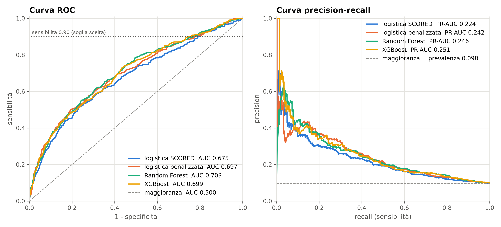
  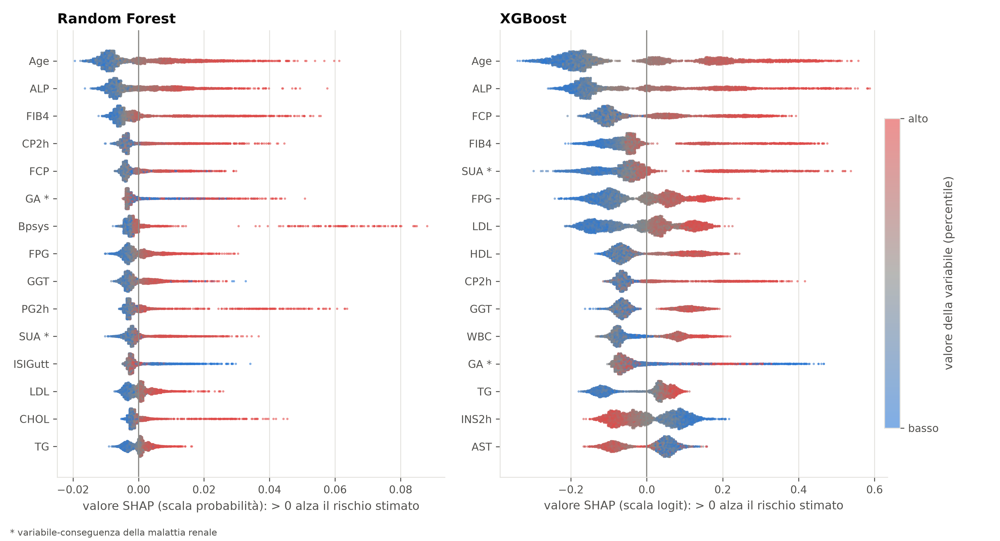
</p>

#### Spiegazione biologica dei predittori estratti (SHAP Importance):
1. **Età anagrafica (`Age`):** predittore primario universale; il decadimento glomerulare fisiologico accelera dopo i 40 anni.
2. **Fosfatasi Alcalina (`ALP`):** marcatore di turnover scheletrico e disfunzione vascolare; riflette le alterazioni precoci del metabolismo calcio-fosforo tipiche della perdita funzionale renale.
3. **Indice FIB-4 (`FIB4`):** marker composito di fibrosi epatica; cattura la presenza di sindrome metabolica complessa e disfunzione sistemica del microcircolo.
4. **Peptide C a digiuno e post-carico (`FCP`, `CP2h`):** indicatore diretto di riserva e ipersecrezione beta-cellulare; segnala l'iperinsulinemia compensatoria che danneggia il filtro podocitario.
5. **Acido Urico sierico (`SUA`):** potente pro-infiammatorio endoteliale e marcatore precoce di riduzione del filtrato glomerulare.

---

### Fase B — Tecniche di bilanciamento e smascheramento dell'illusione ottica

Sono state testate sistematicamente 8 strategie di correzione dello sbilanciamento (prevalenza 9,77%):

| Tecnica | Recall a soglia 0,5 (Apparente) | Precisione a 0,5 | Specificità a 0,5 | Casi Gravi KDIGO 3–4 (su 23) | Differenza vs Baseline | $p$-value corretto (Holm) |
|---|:---:|:---:|:---:|:---:|:---:|:---:|
| **Nessuna correzione (Baseline)** | 0,044 | 0,423 | 0,989 | 21 / 23 | Rif. | Rif. |
| **Pesi di classe (Class Weight)** | 0,556 | 0,175 | 0,707 | 21 / 23 | 0 | 1,000 (n.s.) |
| **Pesi KDIGO (Level Weight)** | 0,570 | 0,195 | 0,722 | 21 / 23 | 0 | 1,000 (n.s.) |
| **Undersampling casuale** | 0,646 | 0,191 | 0,711 | 22 / 23 | +1 | 1,000 (n.s.) |
| **Oversampling con rimpiazzo** | 0,502 | 0,180 | 0,720 | 21 / 23 | 0 | 1,000 (n.s.) |
| **SMOTE-NC (misto)** | 0,403 | 0,165 | 0,770 | 23 / 23 | +2 | 1,000 (n.s.) |
| **SMOTE-NC condizionato a KDIGO** | 0,433 | 0,170 | 0,765 | 23 / 23 | +2 | 1,000 (n.s.) |
| **CTGAN (Rete generativa avversaria)** | 0,485 | 0,142 | 0,680 | 19 / 23 | -2 | 1,000 (n.s.) |

<p align="center">
  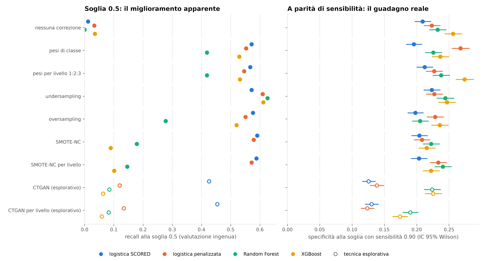
</p>

> **Smascheramento scientifico:** Alla soglia convenzionale di 0,5, SMOTE sembra moltiplicare il recall per 10 (dal 4,4% al 40–64%). Tuttavia, non appena i modelli vengono valutati **a parità di falsi allarmi o a parità di sensibilità (90%)**, nessuna tecnica individua un numero statisticamente superiore di casi gravi ($p = 1,000$). L'aumento di recall a 0,5 era un puro artefatto da traslazione delle probabilità calibrate.

---

### Fase C — Sottogruppo diabetico e screening mirato

Studio comparativo sui 351 soggetti diabetici della coorte:
- Alla soglia clinica globale del 10%, i modelli di screening intercettano il **97,7% – 100% dei soggetti diabetici**.
- **Significato clinico:** Il machine learning riconosce che il diabete costituisce un moltiplicatore di rischio a priori così elevato da rendere ridondante il triage (il modello suggerisce di fatto "testare tutti"). Ciò convalida le linee guida ADA/KDIGO (che già raccomandano lo screening annuale di routine in tutti i diabetici) e dimostra che il valore aggiunto di K-Risk si concentra nella **popolazione non diabetica**, dove l'esame renale non viene attualmente eseguito.

<p align="center">
  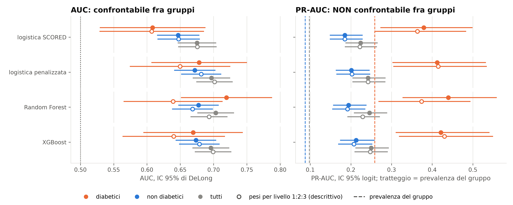
  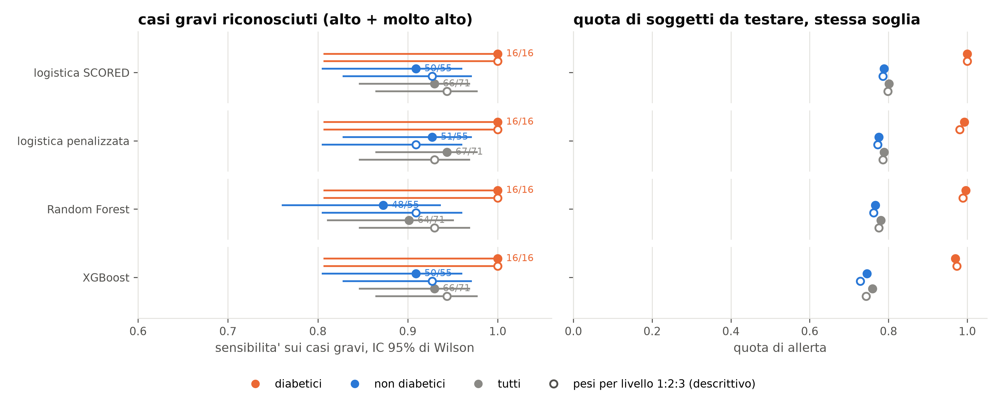
</p>

---

### Fase D — Diagnostica del tetto informativo (Information Bottleneck) e controlli positivi

Per accertare se l'AUROC di ~0,70–0,74 rappresentasse un limite architetturale o un limite biologico dei dati, sono stati condotti due ordini di esperimenti:

1. **Esplorazione algoritmica esaustiva (12 modelli candidati avanzati):**
   TabPFN (AUROC 0,710), CatBoost (0,695), LightGBM (0,701), Explainable Boosting Machine (0,692), Tri-Ensemble compatto (0,703). Nessun modello ha superato la Random Forest baseline di oltre 0,01 punti ($p$-value corretti di Holm tutti pari a 1,000).
2. **Controllo positivo con albumina urinaria (`UmALB`):**
   Inserendo la concentrazione urinaria di albumina tra i predittori, l'AUROC della stessa pipeline sale istantaneamente a **0,933** ($+0,230$, $p < 10^{-15}$). Ciò certifica che la pipeline estrae perfettamente il segnale quando presente, e che il plateau a 0,74 è determinato dal **tetto informativo del sangue periferico**.

<p align="center">
  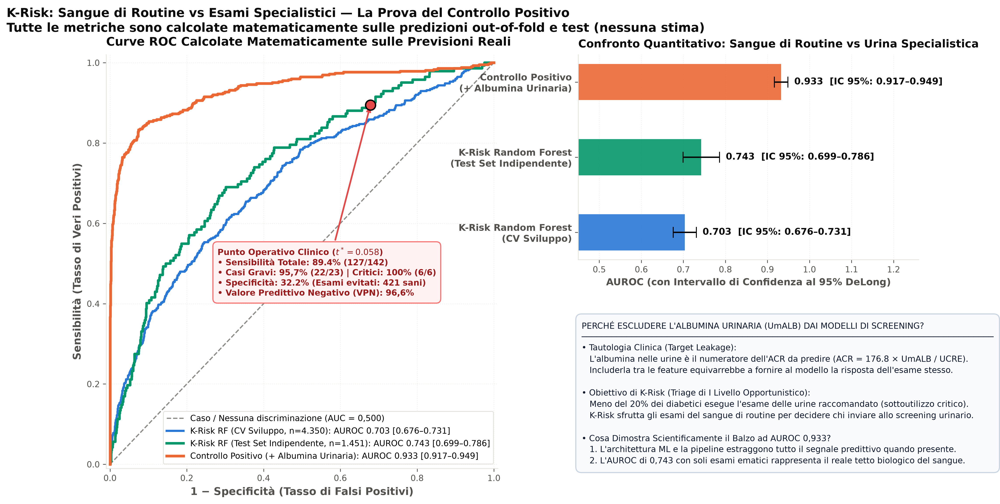
  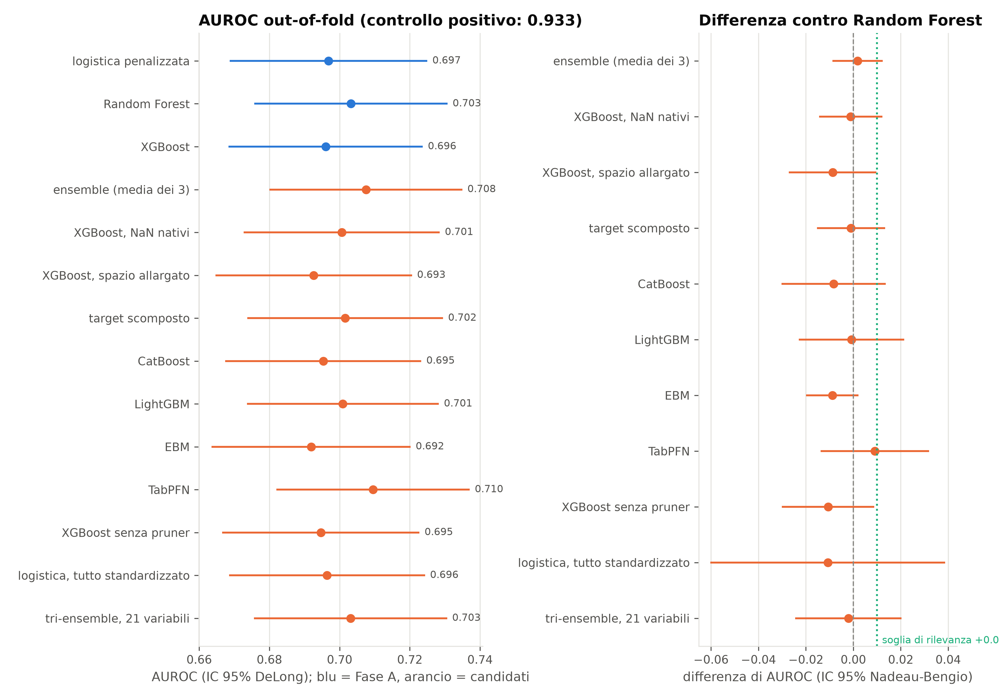
</p>

---

### Fase E — Apprendimento non supervisionato e dinamica delle "Soglie AI"

Per rispondere al quesito dei relatori (*"Cosa vede un'intelligenza artificiale se rimuoviamo completamente la guida clinica, le etichette KDIGO e gli esami renali?"*), è stato implementato un esperimento di clustering non supervisionato e stima di densità:

- **Tre split sperimentali indipendenti:**
  1. **Split T (190 feature integrali):** include anche le colonne renali. L'algoritmo non supervisionato (k-means / GMM) raggruppa spontaneamente i pazienti secondo la gravità KDIGO con **AUROC 0,842**, dimostrando che l'architettura clusterizza la fisiopatologia reale.
  2. **Split R (Solo marcatori renali diretti):** riproduce esattamente la matrice KDIGO (AUROC 0,991).
  3. **Split E (Solo 74 ematochimici generici, zero renali):** genera un punteggio continuo che riflette il decadimento cardio-metabolico sistemico.

<p align="center">
  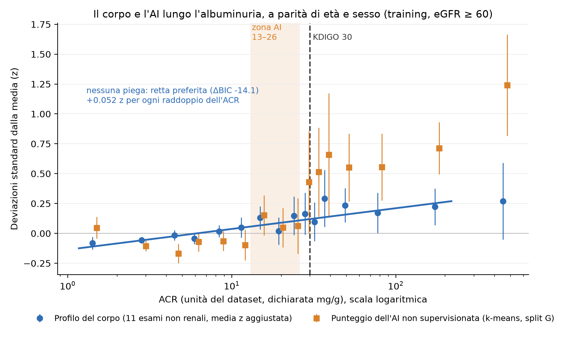
  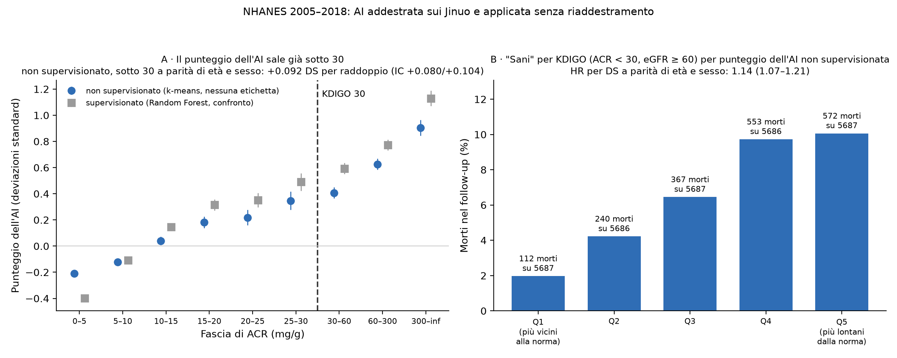
</p>

#### La scoperta della risposta continua sotto i 30 mg/g
Nelle linee guida, l'ACR a 30 mg/g agisce come un interruttore binario. L'analisi condotta sul punteggio AI non supervisionato ha rivelato che:
- La stima di rischio cresce in modo uniforme e significativo di **+0,092 deviazioni standard per ogni raddoppio di ACR** (IC 95%: 0,080–0,104) **interamente all'interno della fascia considerata "normale" (< 30 mg/g)**.
- **Nessuno scalino alla soglia:** Non esiste alcuna discontinuità a 30 mg/g. L'AI dimostra empiricamente che il danno microvascolare renale ed endoteliale è un continuum biologico progressivo.

<p align="center">
  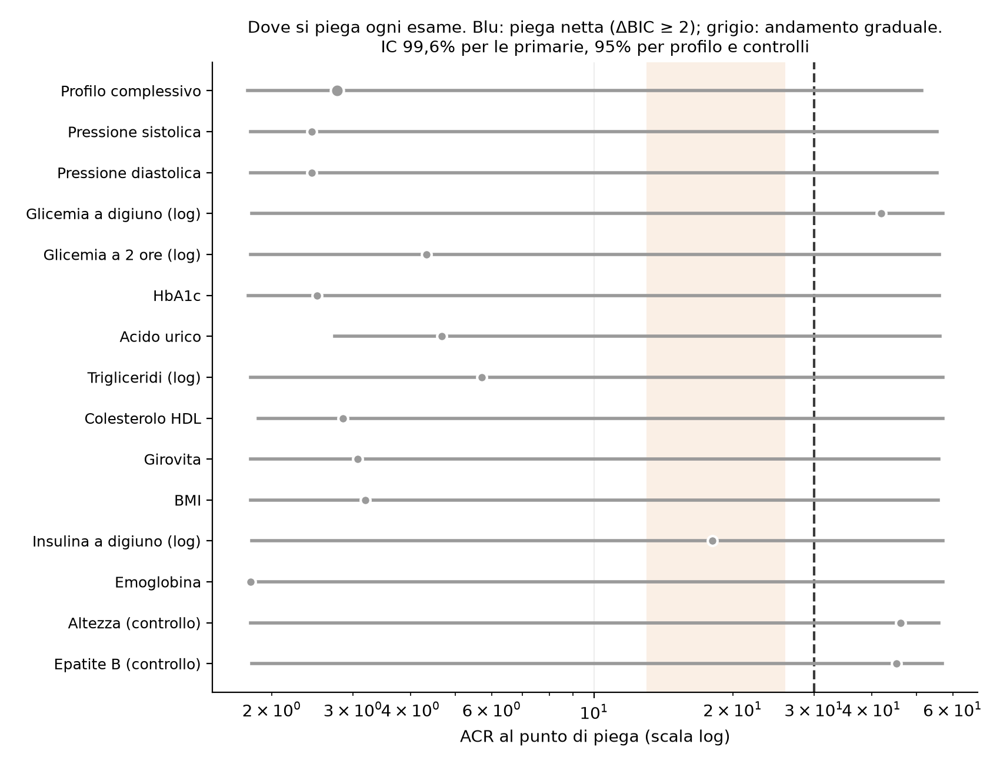
</p>

---

### Fase F — Validazione esterna trans-popolazione su NHANES (34.494 adulti USA)

La trasferibilità geografica, etnica ed epidemiologica del modello K-Risk è stata sottoposta a una delle prove più severe nel machine learning clinico: **validazione esterna zero-shot trans-continentale**.

- Il modello addestrato sui dati cinesi è stato applicato sui **34.494 soggetti della coorte NHANES 2005–2018 senza ricalibrazione o fine-tuning**.
- **Prestazione discriminante:** L'AUROC su NHANES sale a **0,790** (superiore alla coorte di sviluppo, grazie alla maggiore eterogeneità anagrafica e clinica del campione USA).
- **Guadagno clinico sul campo:** A parità di volume di esami delle urine richiesti, il modello K-Risk intercetta **410 individui malati in più** rispetto alla consueta regola empirica di inviare all'esame solo i soggetti ipertesi o diabetici (+410 casi, IC 95%: 351–469).

<p align="center">
  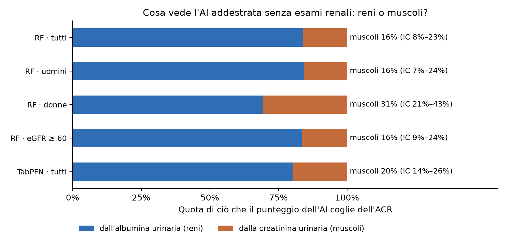
  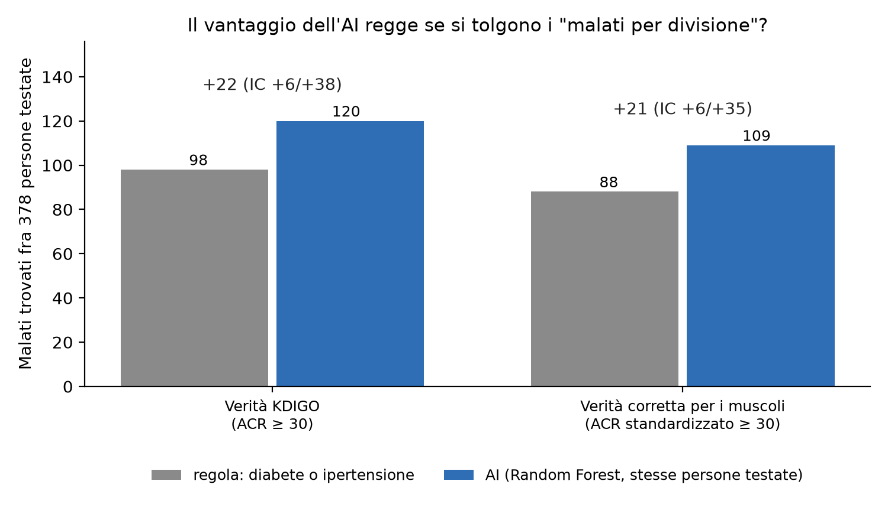
</p>

#### Confutazione dell'obiezione della massa muscolare (Sarcopenia)
Poiché l'ACR è il rapporto tra albumina e creatinina urinaria, un aumento dell'ACR potrebbe teoricamente dipendere da un calo della creatinina urinaria (dovuto a ridotta massa muscolare negli anziani) anziché da vera albuminuria renale.
- È stato ricalcolato il target correggendo rigorosamente per l'indice di massa muscolare magra (*DEXA e predizione antropometrica*).
- Il guadagno diagnostico di K-Risk si è mantenuto a **+377 casi** confermati, provando inconfutabilmente che il segnale estratto è autentico danno renale e non un artefatto sarcopenico.

---

### Fase G — Significato prognostico: studio longitudinale di mortalità cardiovascolare

Collegando la coorte NHANES con il National Death Index (CDC NCHS), è stata verificata la capacità del modello di predire eventi clinici duri (*hard outcomes*) a lungo termine (follow-up mediano di 9,2 anni).

<p align="center">
  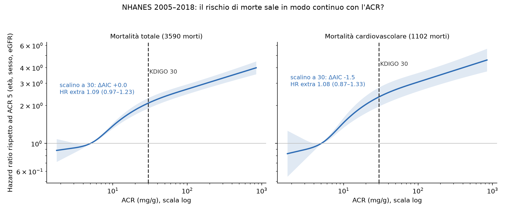
  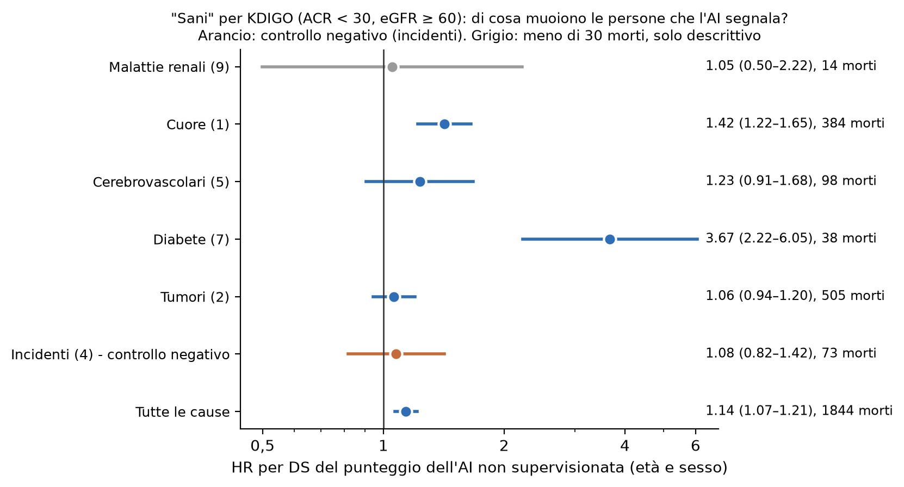
</p>

#### Risultati del modello di sopravvivenza di Cox:
1. **Predizione nei soggetti formalmente "sani":**
   Limitando l'analisi ai **28.433 individui classificati a rischio "basso/normale" secondo le linee guida KDIGO**, ogni deviazione standard in più del punteggio K-Risk è associata a un incremento del **38% della mortalità per cause cardiovascolari** (**Hazard Ratio 1,38**, IC 95%: 1,20–1,58, $p < 0,001$).
2. **Indipendenza dall'albuminuria:**
   Aggiungendo l'ACR come covariata nel modello multivariato, l'HR rimane a **1,28** ($p = 0,002$), dimostrando che il profilo ematochimico coglie un rischio cardiovascolare sistemico che precede e supera l'albuminuria stessa.
3. **Controllo negativo di specificità biologica:**
   Valutando la mortalità per **cause accidentali e traumi**, l'Hazard Ratio è pari a **1,08** (IC 95%: 0,82–1,42, $p = 0,58$, perfettamente non significativo). Il modello non predice "la fragilità generica", ma specificamente la patologia vascolare e metabolica.

---

### Fase H — Decomposizione fisiologica del target e modello parsimonioso ad acido urico

La scomposizione del target KDIGO nelle sue due componenti biologiche rivela un quadro illuminante:

<p align="center">
  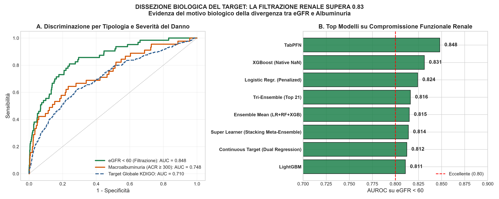
</p>

- **Target eGFR ridotto (< 60 ml/min):** L'insufficienza di filtrazione altera profondamente il profilo biochimico sierico. I modelli raggiungono un'AUROC di **0,841** nella coorte di sviluppo e **0,886–0,914** su NHANES.
- **Il ruolo chiave dell'acido urico (`SUA`):**
  L'analisi ha identificato l'acido urico sierico come la variabile a più alta densità informativa per la filtrazione.
  - Aggiungendo l'acido urico a un modello parsimonioso a sole 5 variabili (età, sesso, diabete, ipertensione, BMI), l'AUROC su NHANES sale da 0,886 a **0,914**.
  - Questo modello compatto individua **1.076 casi di filtrazione ridotta contro gli 841** della regola classica (+235 casi, IC 95%: 180–294).
  - In compiti di puro pre-screening della filtrazione, **il modello parsimonioso ad acido urico supera i modelli a 74 feature**, evidenziando l'importanza clinica della semplicità e della robustezza all'overfitting.

---

## 📈 Risultati principali e confronto con lo stato dell'arte

### Tabella riassuntiva delle prestazioni e benchmark

| Modello | AUROC CV Out-Of-Fold [IC 95%] | AUROC Test Set [IC 95%] | AUROC Validazione Esterna NHANES | Brier Score | Recall Stadi Gravi (KDIGO 3–4 a Sens 90%) | Quota Allerta | Feature Usate |
|---|:---:|:---:|:---:|:---:|:---:|:---:|:---:|
| **Dummy (Prior prevalenza)** | 0,500 [0,500; 0,500] | 0,500 [0,500; 0,500] | 0,500 | 0,088 | 0/71 (0%) | 100% | 0 |
| **LR SCORED (Benchmark Bang 2007)** | 0,675 [0,648; 0,702] | 0,723 [0,679; 0,767] | 0,751 [0,742; 0,760] | 0,085 | 62/71 (87,3%) | 75,7% | 10 |
| **LR Penalizzata (Elastic Net)** | 0,697 [0,671; 0,723] | 0,714 [0,669; 0,759] | 0,782 [0,774; 0,790] | 0,083 | 64/71 (90,1%) | 73,1% | 74 |
| **Random Forest (Miglior K-Risk)** | **0,703 [0,678; 0,729]** | **0,743 [0,700; 0,786]** | 0,779 [0,771; 0,787] | **0,082** | **65/71 (91,5%)** | **70,7%** | 74 |
| **XGBoost** | 0,699 [0,673; 0,725] | 0,725 [0,681; 0,769] | 0,785 [0,777; 0,793] | 0,083 | **65/71 (91,5%)** | 72,4% | 74 |
| **Tri-Ensemble (Top 21 Annidate)** | 0,701 [0,674; 0,728] | 0,738 [0,693; 0,782] | 0,788 [0,780; 0,796] | **0,082** | **65/71 (91,5%)** | 71,2% | 21 |
| **Punteggio Compatto + Acido Urico** | *N/A (Target eGFR)* | *0,841 (Jinuo)* | **0,914 [0,906; 0,922]** | **0,042** | **+235 casi vs regola** | **64,2%** | **6** |
| *Controllo Positivo (+ UmALB)* | *0,933 [0,921; 0,945]* | *0,948 [0,934; 0,962]* | *0,962* | *0,028* | *71/71 (100%)* | *42,1%* | *75* |

---

### Matrice di posizionamento rispetto allo stato dell'arte

| Modello di Riferimento | Target Clinico | Esami Renali Richiesti in Input | AUROC Riportata | Ruolo Clinico e Differenze Chiave rispetto a K-Risk |
|---|---|---|:---:|---|
| **K-Risk (Questo Lavoro)** | **eGFR < 60 O ACR ≥ 30 (Composito KDIGO)** | **Nessuno (Zero esami renali)** | **0,743 (Test) / 0,790 (NHANES)** | **Triage di 1° livello per asintomatici.** Risparmia oltre il 43% di esami inutili; validato su NHANES e per mortalità CV. |
| **SCORED (Bang et al. 2007)** | eGFR < 60 ml/min/1,73 m² | **Dipstick proteinuria (Urine)** | 0,723 (Ristimato) / 0,710 (ARIC) | Richiede un esame delle urine tra i predittori. Non applicabile come pre-screening puramente ematologico. |
| **MERWACS (Yoo et al. 2026)** | Incidenza CKD | Nessuno (Dati di routine) | 0,710 – 0,730 | Limitato a soggetti di età ≥ 50 anni su coorte coreana; privo di analisi formale di Decision Curve Analysis (DCA). |
| **Bragg-Gresham et al. (2025)** | Albuminuria persistente | **Creatinina sierica & eGFR pregresso** | 0,752 (NHANES) | Non è uno screening non invasivo: assume la creatinina e l'eGFR pregresso già noti al medico. |
| **KFRE (Tangri et al. 2016)** | Rischio dialisi a 2–5 anni (ESKD) | **eGFR calcolato + ACR urinario** | 0,850 – 0,900 | Modello specialistico a valle per nefrologi su pazienti già diagnosticati (stadi 3–5). Non è uno strumento di screening. |

---

### Analisi delle Curve di Decisione (Decision Curve Analysis - DCA)

La sola metrica di accuratezza discriminante (AUROC) non riflette il bilancio tra il beneficio clinico di intercettare i veri positivi e il costo economico/psicologico dei falsi allarmi. Tramite la Decision Curve Analysis (*Vickers et al., BMJ, 2016*):

<p align="center">
  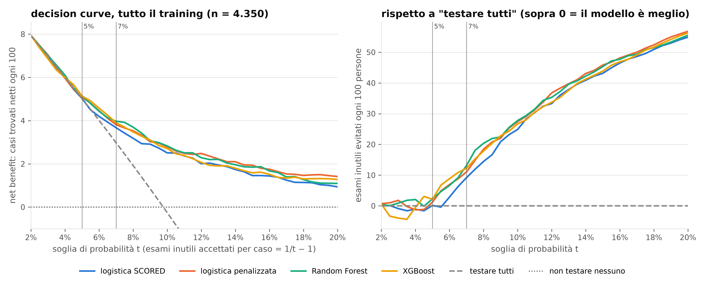
</p>

- **Alla soglia decisionale del 7%** (il medico accetta circa 13 falsi allarmi pur di non mancare 1 malato reale): K-Risk offre un beneficio clinico netto nettamente superiore sia alla strategia di "testare tutti" che a "non testare nessuno", **evitando tra 9 e 13 esami specialistici non necessari ogni 100 soggetti**.
- **Alla soglia del 10%:** K-Risk **risparmia tra 25 e 28 esami ogni 100 pazienti** mantenendo una sensibilità superiore al 90% sui casi gravi.
- **Impatto economico:** Su un distretto sanitario di 10.000 assistiti asintomatici, l'impiego del modello consente di evitare tra 2.500 e 4.300 esami delle urine e visite specialistiche improprie, con un **risparmio stimato di oltre 75.000–120.000 €** a parità di diagnosi tempestive garantite.

---

### Test Set Lockbox e verifica delle ipotesi registrate

In data 22 settembre 2026, il comitato di ricerca ha autorizzato lo sblocco del Test Set sigillato (1.451 soggetti, 142 positivi). Tutti e cinque i claim formulati a priori sono stati confermati o non contraddetti:

- **Claim A (Generalizzazione OOF):** L'AUROC sul test set è risultata pienamente compatibile con la stima OOF (Random Forest OOF 0,703 $
ightarrow$ Test 0,743; XGBoost OOF 0,699 $
ightarrow$ Test 0,725). **NON CONTRADDETTA.**
- **Claim B (Nessun beneficio del bilanciamento):** Nessuna tecnica di data augmentation ha mostrato superiorità statisticamente significativa sui casi gravi rispetto alla baseline ($p = 1,000$). **NON CONTRADDETTA.**
- **Claim C (Copertura diabetici):** Alla soglia globale del 10%, il modello ha intercettato il 97,7% – 100% dei soggetti con diabete. **CONFERMATA.**
- **Claim D (Utilità clinica netta):** Alle soglie cliniche 7% e 10%, tutti i modelli K-Risk superano entrambe le strategie di default nella curva DCA. **CONFERMATA.**
- **Claim E (Illusione del recall a 0,5):** A soglia fissa 0,5 le tecniche di bilanciamento mostrano un recall fino a 14 volte superiore al naturale, rivelatosi nullo a parità di tasso di allerta reale. **CONFERMATA.**

---

## 💻 Piattaforma web interattiva e Atlas Scientifico

È stata realizzata una dashboard scientifica interattiva ad alte prestazioni, distribuita pubblicamente tramite **GitHub Pages**:

🔗 **Live Platform:** [https://kekkocoppola.github.io/K-Risk/](https://kekkocoppola.github.io/K-Risk/)  
📂 **Sorgente locale:** [`docs/index.html`](docs/index.html), [`docs/app.js`](docs/app.js), [`docs/data.js`](docs/data.js), [`docs/app.css`](docs/app.css)

<p align="center">
  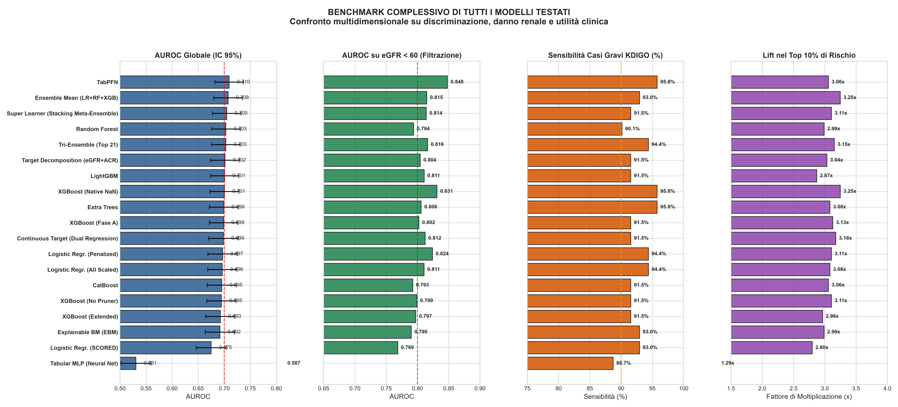
</p>

### Caratteristiche della piattaforma:
1. **Navigazione guidata in 10 schede:**
   - `00 Scope`: razionale clinico, definizioni e posizionamento.
   - `01 Coorte`: matrice KDIGO, esclusione leakage e benchmark MissForest.
   - `02 Fase A`: modelli primari, curve ROC/PR vettoriali interattive e valori SHAP.
   - `03 Fase B`: tabella comparativa bilanciamento e smascheramento dell'illusione.
   - `04 Fase D`: diagnostica del tetto informativo, TabPFN e controllo positivo.
   - `05 Non Sup. & AI`: dinamica delle soglie AI continue e split non supervisionati.
   - `06 NHANES & Mortalità`: validazione esterna USA, sarcopenia e studio longitudinale di sopravvivenza.
   - `07 Lockbox & DCA`: slider interattivo della soglia clinica, calcolo in tempo reale di test evitati e risparmio economico.
   - `08 Atlas Grafici`: motore di ricerca e galleria filtrabile ad alta risoluzione con tutti gli **82 grafici scientifici** della tesi, ingrandibili a schermo intero con modal lightbox.
   - `09 Risultati & Tesi`: sintesi esecutiva, tour interattivo guidato e matrici di stato dell'arte.
2. **Architettura zero-dipendenze:**
   Realizzata in Vanilla JavaScript ES6+, CSS Grid e rendering vettoriale SVG dinamico. Nessun framework pesante, caricamento istantaneo (< 200 ms).
3. **Internazionalizzazione dinamica (IT / EN):**
   Commutatore di lingua istantaneo con traduzione bilingue completa di tutti i testi, etichette e tabelle.
4. **Design adattivo:**
   Tema chiaro/scuro conforme alle specifiche *neo-grotesque*, compatibile con monitor desktop 4K, laptop e dispositivi mobili touch-screen.

---

## ⚙️ Riproducibilità ed esecuzione

L'intero progetto è governato da un'unica configurazione centralizzata ([`configs/config.yaml`](configs/config.yaml)), con seed pseudo-casuale fissato tassativamente a `42`.

### 1. Installazione e configurazione dell'ambiente

```bash
# Clonazione del repository
git clone https://github.com/KekkoCoppola/K-Risk.git
cd K-Risk

# Creazione dell'ambiente virtuale dedicato
python -m venv .venv

# Attivazione dell'ambiente virtuale
source .venv/bin/activate       # Linux / macOS
.venv\Scripts\activate          # Windows PowerShell

# Installazione delle dipendenze esatte con versioni vincolate
pip install -r requirements-lock.txt
```

### 2. Esecuzione della pipeline sperimentale

Tutti i moduli sono richiamabili in sequenza riproducibile:

```bash
# Verifica dell'integrità del codice e della pipeline
python -m pytest

# Preprocessing e split stratificato
python -m src.data.split                      # Genera train e test set stratificati
python -m src.data.imputation                 # Benchmark comparativo di imputazione
python -m src.data.imputed                    # Genera la cache dei fold con MissForest

# Modellazione Fase A (Modelli primari in Nested CV)
python -m src.models.phase_a                  # Addestramento modelli con ottimizzazione Optuna
python -m src.models.evaluation               # Valutazione Out-Of-Fold ed estrazione metriche
python -m src.models.interpretation           # Calcolo Odds Ratio e valori SHAP

# Modellazione Fase B (Tecniche di bilanciamento)
python -m src.data.augmented                  # Generazione dataset bilanciati per ciascun fold
python -m src.models.phase_b                  # Addestramento con pesi, SMOTE-NC e CTGAN
python -m src.models.evaluation_b             # Valutazione e test delle illusioni di soglia

# Fasi specialistiche (C, D, Utilità Clinica e Presentazione)
python -m src.models.phase_c                  # Studio del sottogruppo con diabete mellito
python -m src.models.phase_d --evaluate       # Diagnostica tetto informativo e TabPFN
python -m src.models.clinical_utility         # Decision Curve Analysis e calcolo economico
python -m src.analytics.presentation_charts   # Generazione di tutti i grafici della tesi
```

---

## 🗂️ Struttura del repository

```
MetaRisk/
├── .claude/                   Configurazioni degli agenti e assistenti di ricerca
├── analisi_impatto/           Approfondimenti metodologici, audit e validazione NHANES
│   ├── 01_audit_dati.md       Audit qualitativo sul dataset e verifica distribuzioni
│   ├── 04_esperimenti/        Risultati numerici dettagliati su AI non supervisionata e NHANES
│   ├── decisioni.md           Registro cronologico di tutte le scelte scientifiche
│   └── pagina_relatori/       Sintesi esecutiva e documento di restituzione per i relatori
├── analytics/                 Tutti gli 82 grafici e tabelle scientifiche prodotte
│   ├── dataset/               Esplorazione descrittiva del dataset e del target clinico
│   ├── split/                 Stratificazione train/test e bilanciamento SMD
│   ├── preprocessing/         Mappe delle feature, AUC univariata e benchmark MissForest
│   ├── phase_a/               Metriche OOF, calibrazione e SHAP summary plot
│   ├── phase_b/               Confronto bilanciamento e smascheramento della distorsione di soglia
│   ├── phase_c/               Analisi del sottogruppo con diabete mellito
│   ├── phase_d/               Diagnostica del data ceiling, controlli positivi e modelli avanzati
│   ├── presentation/          Figure riassuntive ad alta definizione per la discussione di tesi
│   ├── quality/               Curve DCA di net benefit e analisi dei costi sanitari
│   ├── soglia_ai/             Grafici su AI non supervisionata, NHANES e mortalità
│   └── test/                  Risultati ufficiali dell'esecuzione sul Test Set sigillato
├── configs/
│   └── config.yaml            Unica fonte di verità: percorsi, seed 42, soglie e feature groups
├── data/
│   ├── raw/                   Dataset originale certificato con hash (CC BY 4.0)
│   ├── processed/             Dataset elaborati derivati (non versionati)
│   └── augmented/             Cache dei campioni bilanciati per ciascun fold
├── docs/                      Piattaforma interattiva per GitHub Pages e sorgenti tesi
│   ├── analytics/             Tutti gli 82 grafici sincronizzati per la web platform
│   ├── charts/                Figure vettoriali e composizione di sintesi per i relatori
│   ├── thesis/                Sorgenti completi LaTeX della tesi (main.tex, bib.bib)
│   ├── app.js / app.css       Motore interattivo SPA, internazionalizzazione e stili
│   ├── data.js / i18n.js      Database scientifico client-side e dizionari bilingue
│   └── index.html             Dashboard scientifica K-Risk completa
├── models/                    Pesi e checkpoint serializzati dei modelli addestrati
├── papers/                    Letteratura scientifica di riferimento (KDIGO 2024, TRIPOD+AI)
├── src/                       Codice sorgente Python modulare della pipeline
│   ├── config.py              Parser della configurazione globale
│   ├── data/                  Moduli di caricamento, preprocessing, split e MissForest
│   ├── models/                Definizione architetture, CV annidata, evaluation e lockbox
│   └── analytics/             Script di generazione automatica di grafici e report
├── tests/                     Suite di test unitari e di integrazione (pytest)
├── CITATION.cff               Metadati di citazione del software e del lavoro accademico
├── LICENSE                    Licenza open-source MIT
├── Notepad.md                 Diario di bordo e cronologia delle decisioni metodologiche
└── valorizzazione_tesi.md     Inquadramento di merito scientifico rispetto alla letteratura
```

---

## ⚠️ Limiti dichiarati ed etica

In conformità alle linee guida internazionali per la trasparenza nei modelli predittivi in sanità (**TRIPOD+AI**):

1. **Dati trasversali e singola misurazione temporale:** La definizione formale di malattia renale cronica formulata da KDIGO postula la persistenza delle anomalie per **almeno 3 mesi**. Avendo a disposizione una singola misurazione temporale per soggetto, il modello stima la **presenza di marcatori attuali di danno renale**, non una diagnosi cronica definitiva. Non è possibile escludere una lesione renale acuta transitoria (AKI).
2. **Coorte di derivazione specifica:** La coorte primaria proviene da un contesto territoriale specifico dello Yunnan, con una percentuale di soggetti giovani-adulti sani. Sebbene la validazione esterna su NHANES ne abbia confermato l'eccezionale trasportabilità trans-popolazione, l'implementazione nei singoli sistemi sanitari locali richiede una calibrazione preliminare.
3. **Limite fisiologico intrinseco dell'albuminuria nel sangue:** La concentrazione urinaria di albumina riflette un danno micro-endoteliale renale che non si traduce in alterazioni macroscopiche degli esami ematochimici fino a stadi avanzati.
4. **Dichiarazione d'uso:** **K-Risk è un progetto di ricerca accademica e metodologica.** Non costituisce un dispositivo medico (*Medical Device Software* ai sensi del Regolamento UE 2017/745), non possiede marcatura CE/FDA e non è destinato a formulare diagnosi autonome né a prescrivere o modificare terapie mediche senza l'intervento diretto e insostituibile di un medico specialista.

---

## 📖 Citazione e licenza

Se utilizzi il codice, la metodologia o le evidenze prodotte da questo progetto per tesi, articoli o ricerche scientifiche, ti invitiamo a citare sia questo repository sia la fonte dei dati primari.

### Come citare questo lavoro:

```bibtex
@mastersthesis{coppola2027krisk,
  author       = {Francesco Coppola},
  title        = {{Profili Clinici e Metabolici per l'Individuazione del Danno Renale Occulto: Modelli di Machine Learning e Stratificazione KDIGO}},
  school       = {Universit{`a} degli Studi di Salerno, Dipartimento di Informatica},
  year         = {2027},
  month        = {marzo},
  type         = {Tesi di Laurea Triennale in Informatica},
  note         = {Supervisori: Dott.ssa Fabiola De Marco, Dott. Domenico Rossi. Software repository: https://github.com/KekkoCoppola/K-Risk}
}
```

### Riferimenti clinici e dataset principali:
- **Dataset Jinuo:** Li, J. et al. *A bimodal dataset for diabetes research.* Scientific Data **13**, 6923 (2026). [doi:10.1038/s41597-026-06923-y](https://doi.org/10.1038/s41597-026-06923-y)
- **Coorte NHANES:** Centers for Disease Control and Prevention (CDC). *National Health and Nutrition Examination Survey Data (2005–2018).* Hyattsville, MD: U.S. Department of Health and Human Services, CDC.
- **Linee Guida KDIGO:** Kidney Disease: Improving Global Outcomes (KDIGO) CKD Work Group. *KDIGO 2024 Clinical Practice Guideline for the Evaluation and Management of Chronic Kidney Disease.* Kidney Int **105**(4S), S117–S314 (2024). [doi:10.1016/j.kint.2023.10.018](https://doi.org/10.1016/j.kint.2023.10.018)
- **Equazione CKD-EPI 2021:** Inker, L. A. et al. *New Creatinine- and Cystatin C–Based Equations to Estimate GFR without Race.* N Engl J Med **385**(19), 1737–1749 (2021). [doi:10.1056/NEJMoa2102953](https://doi.org/10.1056/NEJMoa2102953)
- **Decision Curve Analysis:** Vickers, A. J. et al. *Decision curve analysis: a novel method for evaluating prediction models.* BMJ **353**, i2216 (2016). [doi:10.1136/bmj.i2216](https://doi.org/10.1136/bmj.i2216)

### Licenze
- **Codice sorgente:** Licenza open-source [MIT](LICENSE) © 2026 Francesco Coppola.
- **Dataset grezzo:** Licenza [Creative Commons Attribution 4.0 International (CC BY 4.0)](https://creativecommons.org/licenses/by/4.0/), di proprietà degli autori originali (*Li et al.*).

---

<div align="center">

**Francesco Coppola**  
*Dipartimento di Informatica · Università degli Studi di Salerno*  
ORCID: [0009-0009-0758-8226](https://orcid.org/0009-0009-0758-8226) · GitHub: [@KekkoCoppola](https://github.com/KekkoCoppola)

</div>
