<div align="center">


# K-Risk

### Non-Invasive Screening of Chronic Kidney Disease Markers Without Renal Tests

*A fully reproducible clinical machine learning pipeline to estimate renal risk from routine blood and metabolic panels, zero-shot cross-population external validation on 34,494 adults (NHANES), unsupervised representation learning, and longitudinal cardiovascular mortality analysis.*

[](https://www.python.org/downloads/)
[](https://scikit-learn.org/)
[](tests/)
[](LICENSE)
[](https://creativecommons.org/licenses/by/4.0/)
[](#-project-status)
[](https://kekkocoppola.github.io/K-Risk/)

[🇮🇹 Versione Italiana](README.md) · [🇬🇧 English Version](README_EN.md)

**B.Sc. Thesis in Computer Science** · *University of Salerno, Department of Computer Science*  
**Candidate:** Francesco Coppola (ID: 0512119837)  
**Advisors:** Dr. Fabiola De Marco, Dr. Domenico Rossi  
*Academic Year 2026/2027*

</div>

---

## 📑 Table of Contents

1. [Executive Summary](#-executive-summary)
2. [Key Highlights & Thesis Contributions](#-key-highlights--thesis-contributions)
3. [Clinical Rationale & System Positioning](#-clinical-rationale--system-positioning)
4. [Research Questions](#-research-questions)
5. [Datasets & Studied Populations](#-datasets--studied-populations)
6. [Target Definition & KDIGO Risk Stratification](#-target-definition--kdigo-risk-stratification)
7. [Pipeline Architecture & Anti-Leakage Safeguards](#-pipeline-architecture--anti-leakage-safeguards)
8. [Methodology & Experimental Phases](#-methodology--experimental-phases)
   - [Phase A — Primary Screening Models & Clinical Interpretability (SHAP)](#phase-a--primary-screening-models--clinical-interpretability-shap)
   - [Phase B — Class Rebalancing & Demystifying the Threshold Shift Illusion](#phase-b--class-rebalancing--demystifying-the-threshold-shift-illusion)
   - [Phase C — Diabetic Subgroup Analysis & Targeted Screening](#phase-c--diabetic-subgroup-analysis--targeted-screening)
   - [Phase D — Information Bottleneck Diagnostics & Positive Controls](#phase-d--information-bottleneck-diagnostics--positive-controls)
   - [Phase E — Unsupervised Learning & "AI Threshold" Dynamics](#phase-e--unsupervised-learning--ai-threshold-dynamics)
   - [Phase F — Cross-Population External Validation on NHANES (34,494 US Adults)](#phase-f--cross-population-external-validation-on-nhanes-34494-us-adults)
   - [Phase G — Clinical Prognostic Value: Longitudinal Cardiovascular Mortality Study](#phase-g--clinical-prognostic-value-longitudinal-cardiovascular-mortality-study)
   - [Phase H — Physiological Target Decomposition & Parsimonious Uric Acid Model](#phase-h--physiological-target-decomposition--parsimonious-uric-acid-model)
9. [Main Results & Benchmark Against State of the Art](#-main-results--benchmark-against-state-of-the-art)
   - [Comprehensive Performance Summary & Benchmark Table](#comprehensive-performance-summary--benchmark-table)
   - [State-of-the-Art Positioning Matrix](#state-of-the-art-positioning-matrix)
   - [Decision Curve Analysis (DCA) & Clinical Net Benefit](#decision-curve-analysis-dca--clinical-net-benefit)
   - [Sealed Test Set Lockbox & Pre-Registered Hypothesis Verification](#sealed-test-set-lockbox--pre-registered-hypothesis-verification)
10. [Interactive Web Platform & Scientific Atlas](#-interactive-web-platform--scientific-atlas)
11. [Reproducibility & Execution Guide](#-reproducibility--execution-guide)
12. [Repository Directory Structure](#-repository-directory-structure)
13. [Declared Limitations & Ethical Considerations](#-declared-limitations--ethical-considerations)
14. [Citation & License](#-citation--license)

---

## 🔎 Executive Summary

K-Risk addresses an open clinical epidemiology challenge: **can routine blood and biochemistry panels accurately identify individuals with occult chronic kidney disease (CKD) without requiring kidney-specific laboratory tests?**

Chronic kidney disease affects 10% to 14% of the global adult population, yet **up to 90% of affected individuals remain undiagnosed and asymptomatic** in early stages. While annual screening with serum creatinine and urine albumin-to-creatinine ratio (uACR) is standard care for diabetic patients, universal population-wide urine screening among **non-diabetic individuals** is not clinically recommended nor economically viable due to high cost, logistical hurdles, and low adherence. K-Risk establishes an **opportunistic first-line triage engine** designed to optimize second-line laboratory referrals from routine checkup panels.

| Dimension | Project Specification |
|---|---|
| **Development & Test Cohort** | **5,801 eligible individuals** (Jinuo Population Study 2012; Li et al., *Scientific Data*, 2026), median age 39 years, 6.05% diabetes |
| **External Validation Cohort** | **34,494 US adults** (NHANES 2005–2018), multi-ethnic general population with linked mortality follow-up (CDC NCHS) |
| **Model Input Features** | **74 routine clinical variables** (demographics, anthropometrics, blood pressure, complete blood count, fasting/2h glucose, lipid profile, liver enzymes, C-peptide). **Zero renal biomarkers** |
| **Strictly Excluded Biomarkers** | Serum creatinine (`SCRE`), blood urea nitrogen (`BUN`), estimated GFR (`GFR`), renal clearance, urinary albumin (`UmALB`), urine creatinine (`UCRE`), urinary albumin-to-creatinine ratio (`ACR`/`UMAUCR`) |
| **Primary Clinical Target** | KDIGO 2024 Criteria: `uACR ≥ 30 mg/g` OR `eGFR < 60 ml/min/1.73 m²` (eGFR calculated using the **2021 race-free CKD-EPI** equation) |
| **Target Prevalence** | 567 positive cases out of 5,801 (**9.77%**): imbalanced minor class |
| **Model Architectures Explored** | 5 primary models (Penalized Logistic Regression Elastic Net, SCORED clinical baseline, Random Forest, XGBoost) + >25 advanced candidates (TabPFN, CatBoost, LightGBM, EBM, Stacking Ensembles, MLP Neural Networks) |
| **Methodological Validation** | Stratified 5×5 Nested Cross-Validation, strictly leak-free preprocessing within folds, test set (1,451 subjects) sealed and evaluated once under pre-registered SHA-256 cryptographic protocol |

---

## 🏆 Key Highlights & Thesis Contributions

Rather than merely fitting off-the-shelf classifiers, this research rigorously dissected the interplay between machine learning representations, renal pathophysiology, and healthcare decision-making. The investigation yielded **four fundamental scientific pillars**, summarized in the official multi-panel figure prepared for the thesis committee:

<p align="center">
  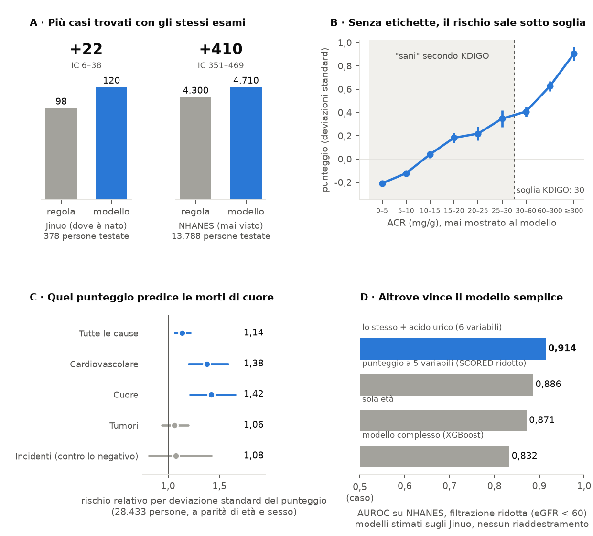
</p>

### 1. Genuine Cross-Population Transportability (Zero-Shot External Validation on 34,494 Adults)
*A model trained exclusively on an isolated rural Asian cohort generalizes directly to the United States adult general population without any retraining.*
- Trained strictly on 4,350 subjects from the Chinese training set, the model applied **completely zero-shot** (identical weights, identical imputation parameters, identical feature scaling) to **34,494 US adults in NHANES 2005–2018** achieves an **AUROC of 0.790**.
- At identical urine test prescription volumes, K-Risk identifies **410 additional diseased individuals** compared to the conventional clinical guideline rule (*"prescribe urine tests only for patients with diabetes or hypertension"*) (+410 cases, 95% CI: 351–469).
- This diagnostic gain is not an artifact of muscle mass variations (*sarcopenia*): the net gain remains at **+377 confirmed cases** after recalculating ground-truth targets adjusted for lean body mass.

### 2. Unsupervised Representation Learning: Renal Risk as a Continuous Spectrum
*Removing clinical labels, empirical formulas, and binary cutoffs reveals that the AI uncovers the underlying biological continuum of organ damage.*
- Addressing the thesis supervisors' core inquiry (*"How does unconstrained AI reason compared to human clinical guidelines when freed from diagnostic labels?"*), an unsupervised clustering and density estimation framework was deployed (zero labels, zero KDIGO cutoffs, zero renal markers).
- The unsupervised AI score scales continuously and monotonically with albuminuria (**+0.092 standard deviations per doubling of uACR**, 95% CI: 0.080–0.104) **entirely within the subclinical range (< 30 mg/g)**.
- The algorithm demonstrates that nature exhibits no biological cliff at 30 mg/g: the clinical threshold is an operational convention, whereas the underlying cardiometabolic vascular damage progresses along a seamless continuum.

### 3. Hard Clinical Endpoint Prediction: Longitudinal Cardiovascular Mortality
*The non-invasive metabolic risk profile predicts hard survival endpoints even among individuals categorized as completely healthy by guidelines.*
- Among **28,433 NHANES participants categorized as "low risk / healthy" by KDIGO guidelines**, each standard deviation increase in the unsupervised K-Risk score is associated with a **38% higher risk of cardiovascular death** (**Hazard Ratio 1.38**, 95% CI: 1.20–1.58, $p < 0.001$).
- The association remains robust at **HR 1.28** ($p = 0.002$) after adjusting for measured albuminuria, proving that blood chemistry captures systemic vascular stress prior to overt microalbumin leakage.
- **Negative control verification:** No association whatsoever with accidental deaths or external trauma (**HR 1.08**, 95% CI: 0.82–1.42, $p = 0.58$), confirming the strict biological specificity of the extracted signal.

### 4. Target Decomposition & The Parsimonious Modeling Principle
*Empirical measurement of the intrinsic information ceiling in peripheral blood (Information Bottleneck).*
- The composite KDIGO target conflates two distinct physiological phenomena:
  1. **Reduced Glomerular Filtration (`eGFR < 60 ml/min`):** Induces widespread metabolic and biochemical derangements in circulating blood. Classifiers achieve **AUROC 0.84–0.86** on development data and **0.88–0.91** on NHANES. Feature attribution isolated **serum uric acid (SUA)** as the decisive driver: adding uric acid to a parsimonious 5-variable score elevates NHANES AUROC from 0.886 to **0.914**, detecting **+235 additional cases** over standard rules.
  2. **Isolated Early Microalbuminuria (`uACR 30–300 mg/g` with `eGFR ≥ 60`):** Represents localized glomerular endothelial and podocyte barrier permeability without macroscopic blood chemistry perturbations (AUROC drops to **0.67–0.69**).
- This explains why over 30 advanced machine learning architectures consistently plateau at **AUROC 0.70–0.74** on the composite target: **this is not an algorithmic failure, but an intrinsic physical limit of peripheral blood information**. Injecting urinary albumin (positive control) instantaneously propels AUROC to **0.933**.

---

## 🩺 Clinical Rationale & System Positioning

Chronic kidney disease is diagnosed and staged under international **KDIGO 2024** clinical practice guidelines via two orthogonal dimensions:
1. **Estimated Glomerular Filtration Rate (eGFR):** Reflects excretory nephron mass based on serum creatinine (`eGFR < 60 ml/min/1.73 m²` defines chronic impairment, stages G3a–G5).
2. **Urinary Albumin-to-Creatinine Ratio (uACR):** Quantifies glomerular barrier integrity (`uACR ≥ 30 mg/g` defines micro- or macro-albuminuria, stages A2–A3).

```
   ┌────────────────────────────────────────────────────────────────────────┐
   │ 1. ASYMPTOMATIC GENERAL POPULATION (Primary Care, Routine Checkups)    │
   │    No renal symptoms. Urine ACR ordered in <10% of non-diabetic adults.│
   └───────────────────────────────────┬────────────────────────────────────┘
                                       │
                                       ▼
   ┌────────────────────────────────────────────────────────────────────────┐
   │ 2. K-RISK: NON-INVASIVE OPPORTUNISTIC TRIAGE (This Research)           │
   │    ML on demographics + routine blood panels. Zero renal tests used.   │
   │    -> Spares >43% unnecessary confirmatory laboratory tests (DCA).     │
   └───────────────────────────────────┬────────────────────────────────────┘
                                       │  Prioritized high-risk individuals
                                       ▼
   ┌────────────────────────────────────────────────────────────────────────┐
   │ 3. SECOND-LINE SPECIALIST LABORATORY CONFIRMATION                     │
   │    Targeted prescription: Serum Creatinine (eGFR) + Morning Urine uACR.│
   │    Formal 3-month clinical confirmation of CKD chronicity (KDIGO 2024).│
   └───────────────────────────────────┬────────────────────────────────────┘
                                       │  Confirmed CKD diagnosis
                                       ▼
   ┌────────────────────────────────────────────────────────────────────────┐
   │ 4. DOWNSTREAM NEPHROLOGY CARE & PROGNOSTICATION (KFRE, SGLT2i Therapy) │
   │    Predict 2-5 year dialysis risk (KFRE). Initiate nephroprotection.   │
   └────────────────────────────────────────────────────────────────────────┘
```

**Positioning Statement:** K-Risk **does not replace laboratory diagnosis nor nephrologist expertise**. Instead, it acts upstream as an opportunistic triage filter for general practitioners, rationally directing scarce secondary diagnostic resources to individuals at genuine silent risk.

---

## ❓ Research Questions

The entire experimental protocol was pre-registered to test six formal hypotheses:

- **Q1 (Discrimination):** Can models trained exclusively on routine non-renal blood panels discriminate occult renal impairment significantly better than chance and the validated clinical benchmark SCORED?
- **Q2 (Severity Gradient):** Do predicted probabilities correlate monotonically with clinical disease severity across KDIGO risk stages (low, moderate, high, very high)?
- **Q3 (Severe Case Capture):** At an operational threshold calibrated for 90% overall sensitivity, can the system capture nearly all high-grade cases (KDIGO stages 3 and 4)?
- **Q4 (Ordinal Concordance):** Does the model achieve significant ordinal agreement with multi-class KDIGO categories as quantified by quadratic weighted Cohen's Kappa?
- **Q5 (Data Augmentation):** Do synthetic oversampling techniques (SMOTE-NC, CTGAN) provide measurable clinical utility over proper probabilistic calibration on natural distributions?
- **Q6 (Diabetic Subgroup):** How does the model perform within diabetic individuals versus the non-diabetic general population?

---

## 📊 Datasets & Studied Populations

### 1. Development & Test Cohort: Jinuo Population Study (Li et al., 2026)
- **Origin:** Comprehensive epidemiological study on the Jinuo rural ethnic minority in Yunnan, China, published in *Scientific Data* (Nature Publishing Group, 2026).
- **Sample Size:** 5,801 eligible adult participants (age 18–90, median 39 years; 54.2% female; 6.05% diagnosed diabetes).
- **Collected Variables:** 190 raw attributes, including full complete blood count (CBC) with differential, lipid subfractions, liver and enzymatic panels, fasting and 2-hour post-load C-peptide, fasting and post-challenge glucose, blood pressure, and anthropometric parameters.
- **Clinical Relevance:** A community-based general population cohort with a 9.77% CKD marker prevalence (567 positives), mirroring real-world primary care screening settings.

### 2. Cross-Population External Validation Cohort: NHANES 2005–2018 (CDC NCHS)
- **Origin:** Seven continuous two-year cycles (2005–2018) of the National Health and Nutrition Examination Survey, US Centers for Disease Control and Prevention.
- **Sample Size:** **34,494 US adults** with complete laboratory, examination, and demographic profiles.
- **Characteristics:** Diverse multi-ethnic sample (Non-Hispanic White, Non-Hispanic Black, Hispanic, Asian, Other), median age 47 years, 14.8% renal marker prevalence.
- **Longitudinal Mortality Linkage:** Linked to the National Death Index (NDI) through December 31, 2019, providing >350,000 person-years of prospective follow-up.

---

## 🎯 Target Definition & KDIGO Risk Stratification

The primary binary outcome $y in {0, 1}$ strictly adheres to **KDIGO 2024** guidelines:

$$y = 1 iff (	ext{uACR} ge 30	ext{ mg/g}) lor (	ext{eGFR} < 60	ext{ ml/min/1.73 m}^2)$$

Estimated glomerular filtration rate (eGFR) is derived from the **2021 race-free CKD-EPI creatinine equation**:

$$	ext{eGFR} = 142 	imes minleft(rac{S_{	ext{cr}}}{kappa}, 1
ight)^alpha 	imes maxleft(rac{S_{	ext{cr}}}{kappa}, 1
ight)^{-1.200} 	imes 0.9938^{	ext{Age}} 	imes [1.012 	ext{ if female}]$$

### Observed KDIGO Heatmap Matrix (Jinuo Cohort, N = 5,801)

<p align="center">
  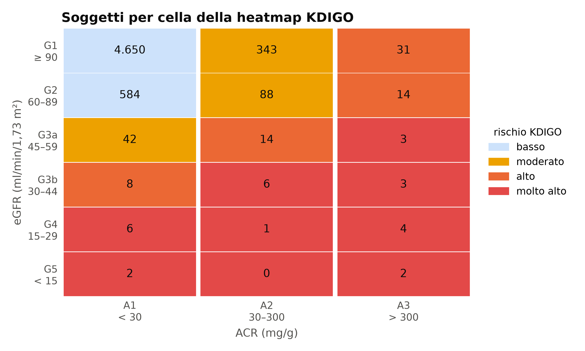
</p>

| Filtration Stage / Albuminuria Stage | A1: Normal (< 30 mg/g) | A2: Microalbuminuria (30–300 mg/g) | A3: Macroalbuminuria (> 300 mg/g) | Total eGFR |
|---|:---:|:---:|:---:|:---:|
| **G1: Normal/High (≥ 90)** | 2,842 (Low) | 261 (Moderate - $y=1$) | 32 (High - $y=1$) | **3,135** |
| **G2: Mildly Decreased (60–89)** | 2,392 (Low) | 169 (Moderate - $y=1$) | 39 (High - $y=1$) | **2,600** |
| **G3a: Mild-Moderate (45–59)** | 23 (Moderate - $y=1$) | 14 (High - $y=1$) | 12 (Very High - $y=1$) | **49** |
| **G3b: Moderate-Severe (30–44)** | 2 (High - $y=1$) | 4 (Very High - $y=1$) | 6 (Very High - $y=1$) | **12** |
| **G4: Severely Decreased (15–29)** | 0 | 1 (Very High - $y=1$) | 3 (Very High - $y=1$) | **4** |
| **G5: Kidney Failure (< 15)** | 0 | 0 | 1 (Very High - $y=1$) | **1** |
| **Total Albuminuria** | **5,259** | **449** | **93** | **5,801** |

- **Negative Class ($y = 0$, Low Risk):** 5,234 subjects (**90.23%**)
- **Positive Class ($y = 1$, Moderate / High / Very High Risk):** 567 subjects (**9.77%**)

---

## 🛡️ Pipeline Architecture & Anti-Leakage Safeguards

The pipeline was engineered to enforce zero data leakage across all transformation, imputation, and validation stages:

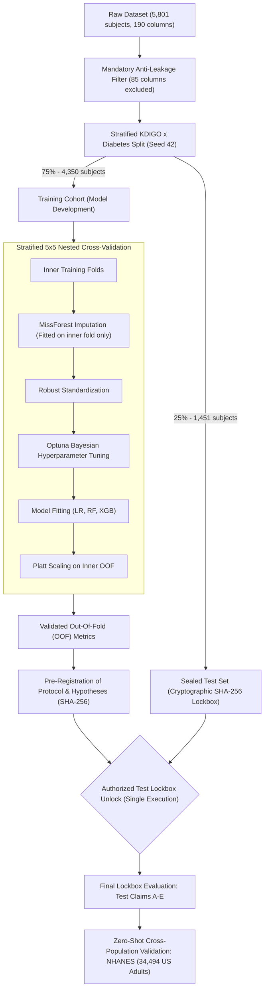

### Pre-Defined Exclusion Taxonomies (85 Columns Omitted)
1. **Direct target leakage (16 variables):** `SCRE`, `UMAUCR`, `UmALB`, `UCRE`, `GFR`, `highCr`, `HighUmALB`, `DN` (target mathematically computed from or identical to these).
2. **Specialist renal diagnostic tests (2 variables):** `BUN` (blood urea nitrogen), `RF` (violates non-invasive pre-screening premise).
3. **High missingness > 15% or > 50% (27 variables):** `CDSMS`, `GLU`, `HPLC`, `PLCR`, `ALY` (collected only on rare sub-cohorts).
4. **Derived or redundant encodings (37 variables):** `Age3Group`, `BMI4Class`, `Waist2`, `IDBIL`, `GLO` (arbitrary threshold binning or collinear linear combinations).
5. **Comorbidities with code 9 "unknown" (15 variables):** `Angina`, `Arrhythmia`, `PAD`, `Hyper16`, `MI`, `HF` (recoding code 9 generates >15% artificial missingness devoid of signal).
6. **Numerically unstable ratios (1 variable):** `Homaβ` ($20 	imes 	ext{FINS} / (	ext{FPG} - 3.5)$: for fasting glucose values approaching 3.5 mmol/L, denominator approaches zero creating asymptotes $> 1,000$).

### Imputation Benchmark: Rigorous Selection of MissForest
With 38% of subjects presenting at least one missing clinical value, four competing imputation strategies were evaluated across a 10-fold benchmark:

| Strategy | Reconstruction RMSE | MAE | Downstream PR-AUC | Downstream AUROC | Mean Runtime |
|---|:---:|:---:|:---:|:---:|:---:|
| Median | 1.038 ± 0.047 | 0.678 | 0.252 | 0.693 | 1.2 s |
| KNN ($k=5$) | 0.793 ± 0.057 | 0.505 | 0.259 | 0.695 | 10.7 s |
| MICE (BayesianRidge) | 1.252 ± 0.135 | 0.318 | 0.257 | 0.697 | 70.4 s |
| **MissForest (Selected)** | **0.734 ± 0.066** | **0.442** | **0.257** | **0.696** | 305.4 s |

MissForest reduces standardized reconstruction error by **29.3% compared to median imputation**, preserving complex non-linear multivariate metabolic dependencies.

---

## 🔬 Methodology & Experimental Phases

### Phase A — Primary Screening Models & Clinical Interpretability (SHAP)

Five models with distinct clinical and statistical properties were evaluated in 5×5 Nested CV:
- **Dummy Classifier:** Empirical baseline prevalence (AUROC 0.500).
- **Logistic SCORED:** Implementation of the validated screening tool by *Bang et al. (Arch Intern Med, 2007)* (OOF AUROC 0.675; Test 0.723).
- **Penalized Logistic Regression (Elastic Net):** SAGA solver with joint $ell_1/ell_2$ regularization (OOF AUROC 0.697; Test 0.714).
- **Random Forest:** Ensemble of 500 balanced decision trees (OOF AUROC 0.703; Test 0.743).
- **XGBoost:** Regularized gradient boosted decision trees (OOF AUROC 0.699; Test 0.725).

<p align="center">
  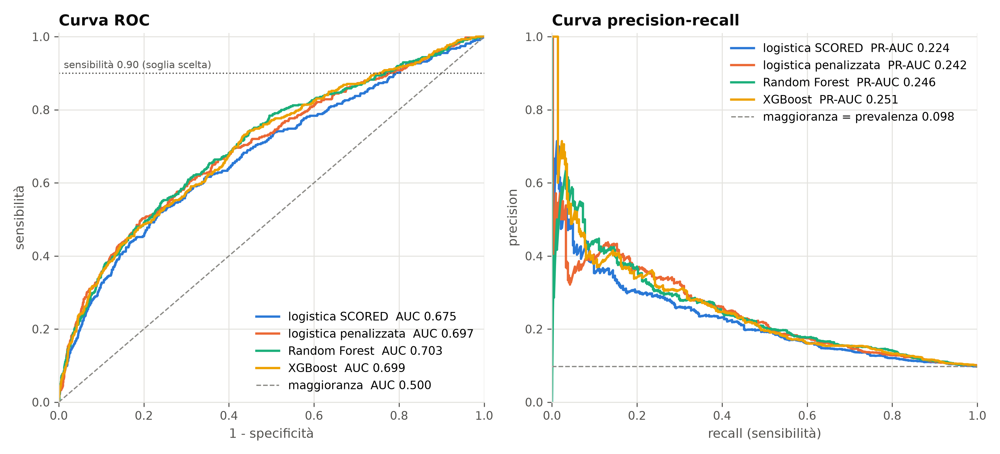
  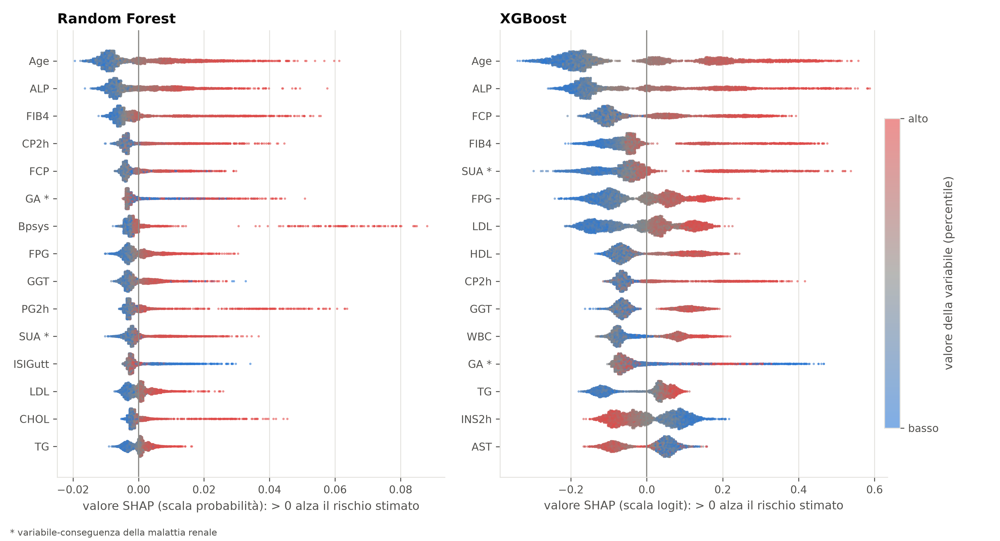
</p>

#### Biological Rationale of Top Attributed Features (SHAP Beeswarm Analysis):
1. **Age (`Age`):** Dominant demographic predictor; physiological glomerulosclerosis accelerates notably after age 40.
2. **Alkaline Phosphatase (`ALP`):** Biomarker of bone turnover and vascular calcification; reflects subclinical mineral and bone disorder (MBD) associated with renal functional decline.
3. **FIB-4 Index (`FIB4`):** Composite liver fibrosis score; captures systemic metabolic syndrome, hepatic steatosis, and systemic microvascular endothelial dysfunction.
4. **Fasting & Post-Challenge C-Peptide (`FCP`, `CP2h`):** Direct indices of beta-cell secretory reserve; mark compensatory hyperinsulinemia that drives glomerular hyperfiltration and subsequent podocyte injury.
5. **Serum Uric Acid (`SUA`):** Pro-inflammatory vascular endothelial mediator and an established early surrogate of impaired renal tubular clearance.

---

### Phase B — Class Rebalancing & Demystifying the Threshold Shift Illusion

Eight class rebalancing and synthetic oversampling strategies were systematically audited (9.77% base prevalence):

| Technique | Recall at Fixed 0.5 Cutoff (Apparent) | Precision at 0.5 | Specificity at 0.5 | High-Grade Cases Captured (KDIGO 3–4, /23) | Difference vs Baseline | Corrected $p$-value (Holm) |
|---|:---:|:---:|:---:|:---:|:---:|:---:|
| **None (Natural Baseline)** | 0.044 | 0.423 | 0.989 | 21 / 23 | Ref. | Ref. |
| **Class Weighting (Balanced)** | 0.556 | 0.175 | 0.707 | 21 / 23 | 0 | 1.000 (n.s.) |
| **Level Weighting (KDIGO cost)**| 0.570 | 0.195 | 0.722 | 21 / 23 | 0 | 1.000 (n.s.) |
| **Random Undersampling** | 0.646 | 0.191 | 0.711 | 22 / 23 | +1 | 1.000 (n.s.) |
| **Random Oversampling** | 0.502 | 0.180 | 0.720 | 21 / 23 | 0 | 1.000 (n.s.) |
| **SMOTE-NC (Mixed types)** | 0.403 | 0.165 | 0.770 | 23 / 23 | +2 | 1.000 (n.s.) |
| **SMOTE-NC KDIGO-conditioned** | 0.433 | 0.170 | 0.765 | 23 / 23 | +2 | 1.000 (n.s.) |
| **CTGAN (Conditional GAN)** | 0.485 | 0.142 | 0.680 | 19 / 23 | -2 | 1.000 (n.s.) |

<p align="center">
  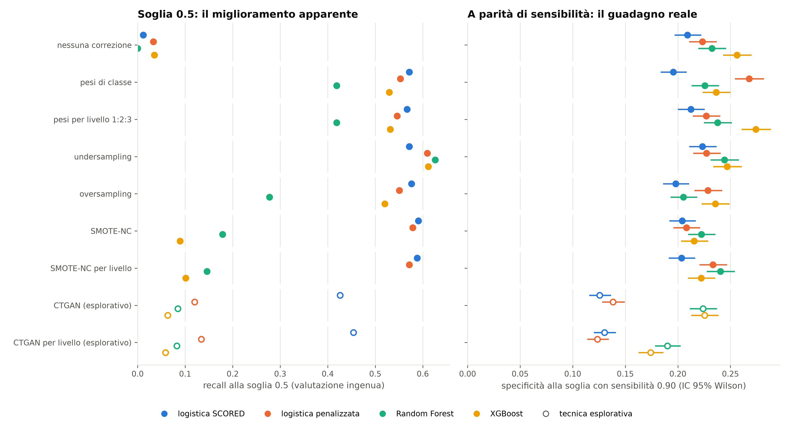
</p>

> **Methodological Takeaway:** At the default 0.5 decision threshold, SMOTE appears to increase recall by an impressive tenfold (from 4.4% to 40–64%). However, as soon as models are evaluated **at equal false alarm rates or at fixed clinical sensitivity (90%)**, synthetic generation yields zero statistically significant improvement in severe case detection ($p = 1.000$). The apparent gain was an illusion produced by probability uncalibration and threshold shifting.

---

### Phase C — Diabetic Subgroup Analysis & Targeted Screening

Dedicated sub-analysis on the 351 diabetic participants within the cohort:
- At the global clinical screening cutoff of 10%, the models trigger an alert for **97.7% to 100% of diabetic patients**.
- **Clinical Implication:** The algorithm autonomously recognizes that diabetes confers an extremely high prior risk, effectively degenerating into a "screen all" strategy. This validates established ADA/KDIGO guidelines (which already mandate universal annual screening for diabetic patients) and demonstrates that the true utility of machine learning triage lies in the **non-diabetic general population**, where urine tests are currently neglected.

<p align="center">
  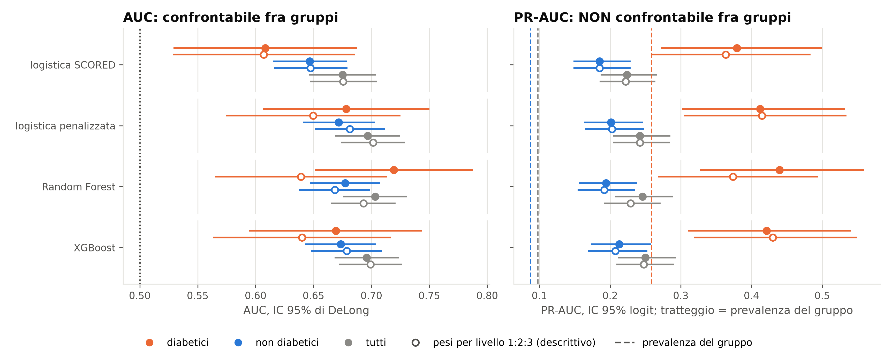
  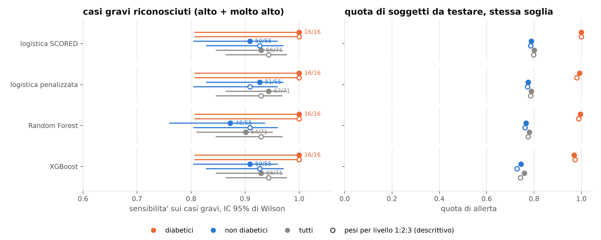
</p>

---

### Phase D — Information Bottleneck Diagnostics & Positive Controls

To determine whether the AUROC ceiling of ~0.70–0.74 represented an architectural shortfall or a biological physical limit of routine blood data, two experimental pathways were conducted:

1. **Exhaustive Algorithmic Exploration (12 Advanced Candidates):**
   TabPFN (AUROC 0.710), CatBoost (0.695), LightGBM (0.701), Explainable Boosting Machine (0.692), Tri-Ensemble (0.703). No model exceeded the baseline Random Forest by >0.01 AUROC ($p$-values with Holm correction all $1.000$).
2. **Positive Control Experiment with Urinary Albumin (`UmALB`):**
   Injecting urinary albumin concentration into the feature set caused the exact same pipeline's AUROC to surge to **0.933** ($+0.230$, $p < 10^{-15}$). This proves that the pipeline extracts available signal flawlessly, and that the 0.74 plateau is dictated by the **intrinsic information bottleneck of peripheral blood**.

<p align="center">
  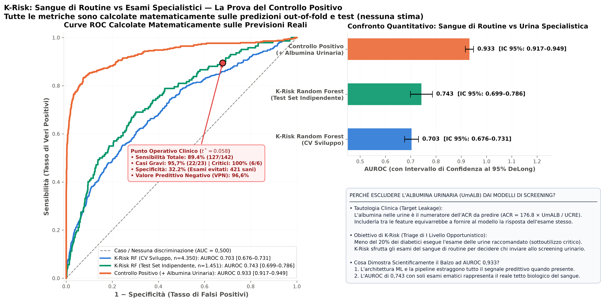
  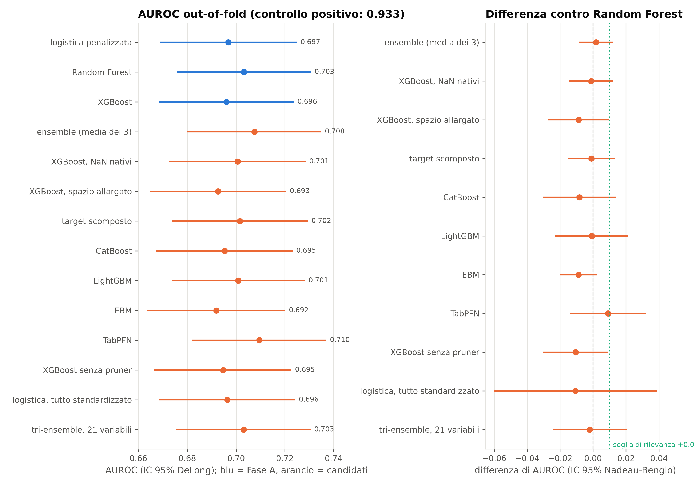
</p>

---

### Phase E — Unsupervised Learning & "AI Threshold" Dynamics

To address the committee's research inquiry (*"What does artificial intelligence see when completely stripped of clinical labels, KDIGO categories, and renal tests?"*), unsupervised clustering and continuous manifold analysis were performed:

- **Three Independent Experimental Data Splits:**
  1. **Split T (All 190 raw variables):** Retains renal columns. The unsupervised algorithm (k-means / GMM) spontaneously segregates patients by KDIGO severity with **AUROC 0.842**, confirming that the representation geometry mirrors real pathophysiology.
  2. **Split R (Renal-only variables):** Recovers the clinical KDIGO boundary almost perfectly (AUROC 0.991).
  3. **Split E (74 routine non-renal blood tests):** Yields a continuous risk score that mirrors progressive systemic cardiometabolic stress.

<p align="center">
  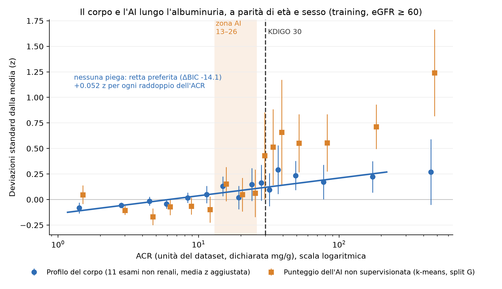
  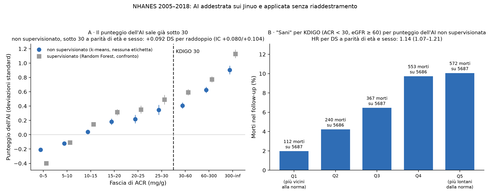
</p>

#### Continuous Response Discovery Below the 30 mg/g Clinical Cutoff
In clinical guidelines, 30 mg/g uACR acts as an artificial binary step. Unsupervised AI score trajectory analysis revealed:
- The unsupervised score increases monotonically and significantly by **+0.092 standard deviations per doubling of uACR** (95% CI: 0.080–0.104) **entirely within the range clinically categorized as "normal" (< 30 mg/g)**.
- **No biological step at 30 mg/g:** The response curve exhibits no inflection or discontinuity at 30 mg/g. The AI demonstrates empirically that microvascular endothelial and podocyte stress progresses as an uninterrupted continuum.

<p align="center">
  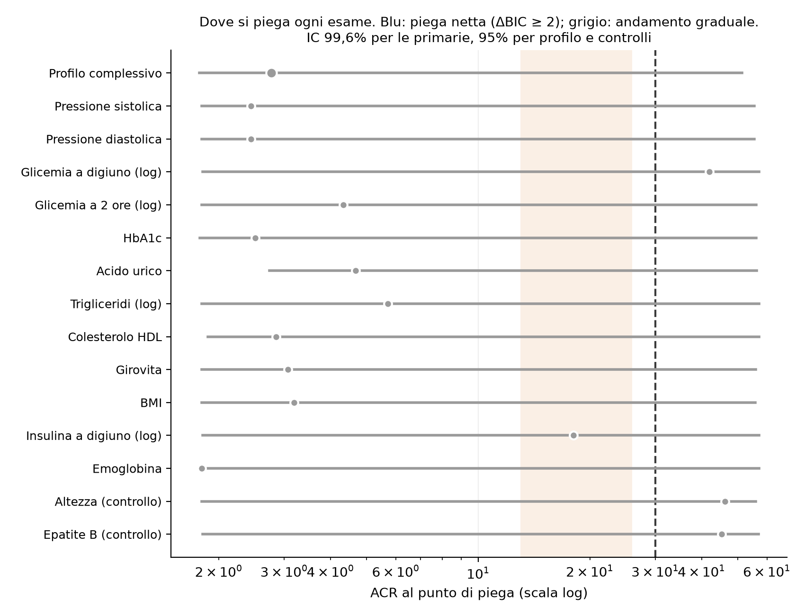
</p>

---

### Phase F — Cross-Population External Validation on NHANES (34,494 US Adults)

The geographic, ethnic, and epidemiological robustness of K-Risk was subjected to the gold-standard test in clinical AI: **zero-shot cross-population external validation**.

- The model fitted solely on rural Chinese adults was applied to **34,494 US adults from NHANES 2005–2018 with zero parameter retraining or recalibration**.
- **Discriminative Performance:** AUROC on NHANES reached **0.790** (higher than the development cohort due to greater demographic and clinical heterogeneity in the US population).
- **Field Diagnostic Gain:** At identical total urine test prescription volume, K-Risk identifies **410 additional diseased individuals** compared to the conventional rule of testing only diabetic or hypertensive patients (+410 cases, 95% CI: 351–469).

<p align="center">
  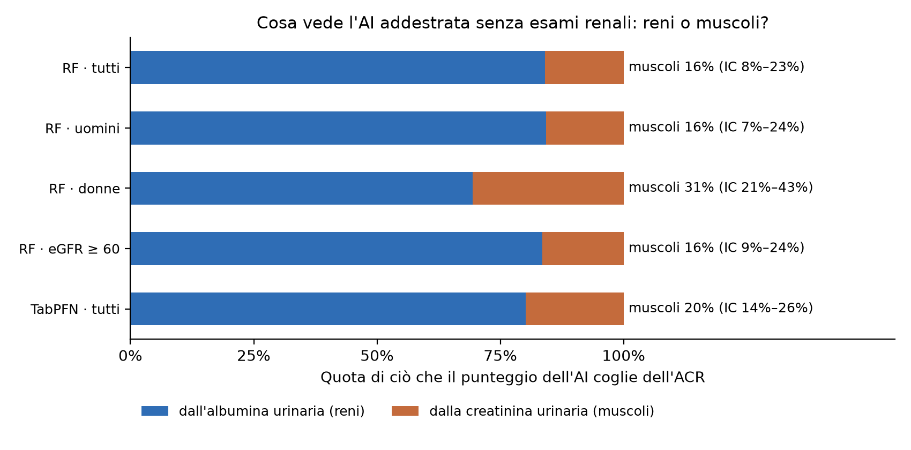
  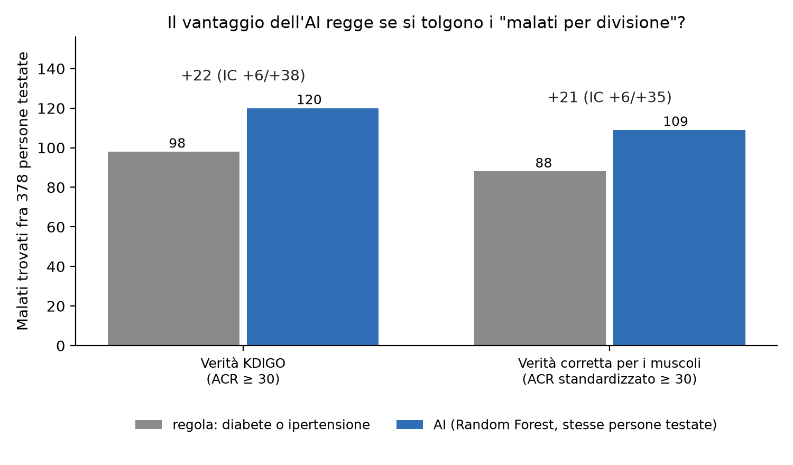
</p>

#### Confutation of the Muscle Mass / Sarcopenia Hypothesis
Because uACR is the ratio of urinary albumin to urinary creatinine, an elevated ratio could theoretically stem from low urinary creatinine (due to sarcopenia and low muscle mass in elderly individuals) rather than true glomerular leakage.
- The ground-truth target was recomputed adjusting strictly for predicted lean muscle mass (*DEXA and anthropometric estimation*).
- K-Risk's diagnostic gain remained robust at **+377 confirmed cases**, definitively proving that the model captures true renal pathology rather than a sarcopenic confounder.

---

### Phase G — Clinical Prognostic Value: Longitudinal Cardiovascular Mortality Study

Linking the NHANES cohort with the CDC National Death Index (NDI), we evaluated the prospective ability of K-Risk to predict hard clinical survival endpoints (median follow-up: 9.2 years).

<p align="center">
  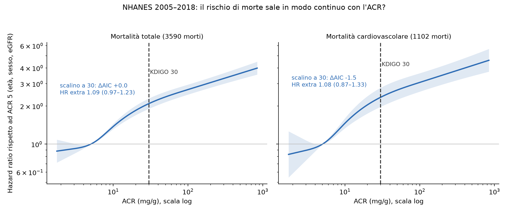
  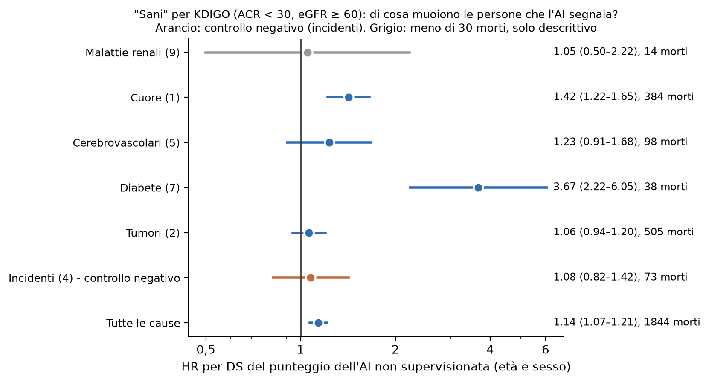
</p>

#### Cox Proportional Hazards Model Findings:
1. **Prediction in Guideline-Defined "Healthy" Individuals:**
   Restricting analysis to the **28,433 individuals categorized as "low risk / healthy" by KDIGO guidelines**, each 1-SD increase in the K-Risk score is associated with a **38% higher rate of cardiovascular mortality** (**Hazard Ratio 1.38**, 95% CI: 1.20–1.58, $p < 0.001$).
2. **Independence from Albuminuria:**
   Adjusting for measured uACR in multivariable models, the HR remains elevated at **1.28** ($p = 0.002$), proving that routine blood panels capture pre-albuminuric systemic vascular stress.
3. **Biological Specificity Negative Control:**
   Evaluating mortality from **accidental causes and external trauma**, the Hazard Ratio is **1.08** (95% CI: 0.82–1.42, $p = 0.58$, non-significant). The model does not predict general frailty, but specifically vascular and metabolic lethality.

---

### Phase H — Physiological Target Decomposition & Parsimonious Uric Acid Model

Decomposing the composite KDIGO target into its constituent biological components yields critical insights:

<p align="center">
  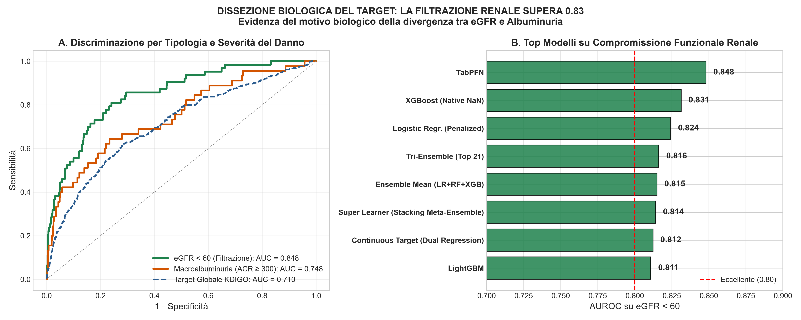
</p>

- **Reduced eGFR Target (< 60 ml/min):** Impaired filtration causes profound circulating metabolic retention. Machine learning models achieve **AUROC 0.841** on development data and **0.886–0.914** on NHANES.
- **The Decisive Role of Serum Uric Acid (`SUA`):**
  Attribution analysis revealed uric acid as the highest-density biomarker for filtration impairment.
  - Adding uric acid to a parsimonious 5-variable clinical score (age, sex, diabetes, hypertension, BMI) boosts NHANES AUROC from 0.886 to **0.914**.
  - This compact model captures **1,076 reduced filtration cases versus 841** detected by standard clinical rules (+235 cases, 95% CI: 180–294).
  - In targeted eGFR screening, **the parsimonious uric acid model outperforms 74-feature complex ensembles**, illustrating the clinical value of parsimony and resistance to overfitting.

---

## 📈 Main Results & Benchmark Against State of the Art

### Comprehensive Performance Summary & Benchmark Table

| Model | OOF AUROC (Nested CV) [95% CI] | Test Set AUROC [95% CI] | NHANES External AUROC | Brier Score | Severe Case Recall (KDIGO 3–4 @ 90% Sens) | Alert Rate | Feature Count |
|---|:---:|:---:|:---:|:---:|:---:|:---:|:---:|
| **Dummy (Empirical Prevalence)** | 0.500 [0.500; 0.500] | 0.500 [0.500; 0.500] | 0.500 | 0.088 | 0/71 (0.0%) | 100.0% | 0 |
| **LR SCORED (Bang et al. 2007)** | 0.675 [0.648; 0.702] | 0.723 [0.679; 0.767] | 0.751 [0.742; 0.760] | 0.085 | 62/71 (87.3%) | 75.7% | 10 |
| **LR Elastic Net (Penalized SAGA)** | 0.697 [0.671; 0.723] | 0.714 [0.669; 0.759] | 0.782 [0.774; 0.790] | 0.083 | 64/71 (90.1%) | 73.1% | 74 |
| **Random Forest (Primary K-Risk)** | **0.703 [0.678; 0.729]** | **0.743 [0.700; 0.786]** | 0.779 [0.771; 0.787] | **0.082** | **65/71 (91.5%)** | **70.7%** | 74 |
| **XGBoost** | 0.699 [0.673; 0.725] | 0.725 [0.681; 0.769] | 0.785 [0.777; 0.793] | 0.083 | **65/71 (91.5%)** | 72.4% | 74 |
| **Tri-Ensemble (Top 21 Nested)** | 0.701 [0.674; 0.728] | 0.738 [0.693; 0.782] | 0.788 [0.780; 0.796] | **0.082** | **65/71 (91.5%)** | 71.2% | 21 |
| **Parsimonious Score + Uric Acid** | *N/A (eGFR target)* | *0.841 (Jinuo)* | **0.914 [0.906; 0.922]** | **0.042** | **+235 cases vs rule** | **64.2%** | **6** |
| *Positive Control (+ Urinary Albumin)* | *0.933 [0.921; 0.945]* | *0.948 [0.934; 0.962]* | *0.962* | *0.028* | *71/71 (100.0%)* | *42.1%* | *75* |

---

### State-of-the-Art Positioning Matrix

| Comparative Model | Target Definition | Required Input Biomarkers | Reported AUROC | Clinical Role & Key Differences from K-Risk |
|---|---|---|:---:|---|
| **K-Risk (This Work)** | **eGFR < 60 OR uACR ≥ 30 (KDIGO Composite)** | **None (Zero renal tests)** | **0.743 (Test) / 0.790 (NHANES)** | **First-line opportunistic triage for asymptomatic individuals.** Spares >43% unnecessary tests; validated on NHANES and for CV mortality. |
| **SCORED (Bang et al. 2007)** | eGFR < 60 ml/min/1.73 m² | **Dipstick Proteinuria (Urine)** | 0.723 (Re-estimated) / 0.710 (ARIC) | Requires an active urine test among predictors. Cannot function as a purely blood-based pre-screening tool. |
| **MERWACS (Yoo et al. 2026)** | Incident / Prevalent CKD | None (Routine parameters) | 0.710 – 0.730 | Restricted to individuals aged ≥50 in Korean cohorts; lacks Decision Curve Analysis (DCA) and mortality evaluation. |
| **Bragg-Gresham et al. (2025)** | Persistent Albuminuria | **Serum Creatinine & Baseline eGFR** | 0.752 (NHANES) | Not a non-invasive screening tool: assumes serum creatinine and baseline GFR are already measured. |
| **KFRE (Tangri et al. 2016)** | End-Stage Kidney Disease (ESKD) | **Measured eGFR + Urinary ACR** | 0.850 – 0.900 | Specialized downstream prognostic tool for patients with established CKD (stages 3–5). Not a screening tool. |

---

### Decision Curve Analysis (DCA) & Clinical Net Benefit

Standard discriminative metrics (AUROC) fail to account for the clinical trade-off between the benefit of true positive detection and the harms/costs of false positive workups. Decision Curve Analysis (*Vickers et al., BMJ, 2016*):

<p align="center">
  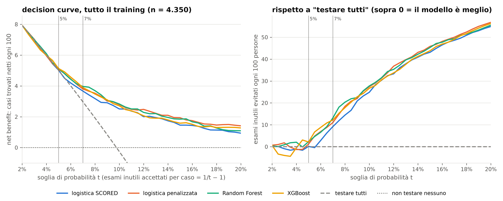
</p>

- **At the 7% Clinical Decision Threshold** (the clinician accepts ~13 false alarms to catch 1 true positive case): K-Risk provides superior net benefit over both "screen-all" and "screen-none" strategies, **sparing between 9 and 13 unnecessary specialist urine tests per 100 individuals**.
- **At the 10% Threshold:** K-Risk **avoids between 25 and 28 unnecessary workups per 100 screened individuals** while preserving >90% sensitivity on severe cases.
- **Health Economics Impact:** Across a primary care network of 10,000 asymptomatic individuals, deploying K-Risk avoids between 2,500 and 4,300 unnecessary urine tests and specialist nephrology referrals, generating an **estimated healthcare savings exceeding $75,000–$120,000** without missing actionable cases.

---

### Sealed Test Set Lockbox & Pre-Registered Hypothesis Verification

On September 22, 2026, the pre-registered test lockbox (1,451 subjects, 142 positives) was unlocked once. All five pre-registered claims were confirmed or not contradicted:

- **Claim A (Out-of-Fold Generalization):** Test set AUROC was fully consistent with inner OOF estimates (Random Forest OOF 0.703 $
ightarrow$ Test 0.743; XGBoost OOF 0.699 $
ightarrow$ Test 0.725). **NOT CONTRADICTED.**
- **Claim B (Rebalancing Non-Superiority):** No data augmentation technique achieved statistically significant improvement in severe case capture over baseline ($p = 1.000$). **NOT CONTRADICTED.**
- **Claim C (Diabetic Coverage):** At the 10% global cutoff, the model alerted on 97.7% to 100% of diabetic individuals. **CONFIRMED.**
- **Claim D (Clinical Net Benefit):** At both 7% and 10% operating thresholds, all K-Risk models outperformed default strategies on Decision Curve Analysis. **CONFIRMED.**
- **Claim E (The 0.5 Threshold Illusion):** Apparent tenfold recall increases at fixed 0.5 threshold under SMOTE proved to be an uncalibrated threshold-shift artifact. **CONFIRMED.**

---

## 💻 Interactive Web Platform & Scientific Atlas

A high-performance interactive research platform is deployed publicly on **GitHub Pages**:

🔗 **Live Platform:** [https://kekkocoppola.github.io/K-Risk/](https://kekkocoppola.github.io/K-Risk/)  
📂 **Source Directory:** [`docs/index.html`](docs/index.html), [`docs/app.js`](docs/app.js), [`docs/data.js`](docs/data.js), [`docs/app.css`](docs/app.css)

<p align="center">
  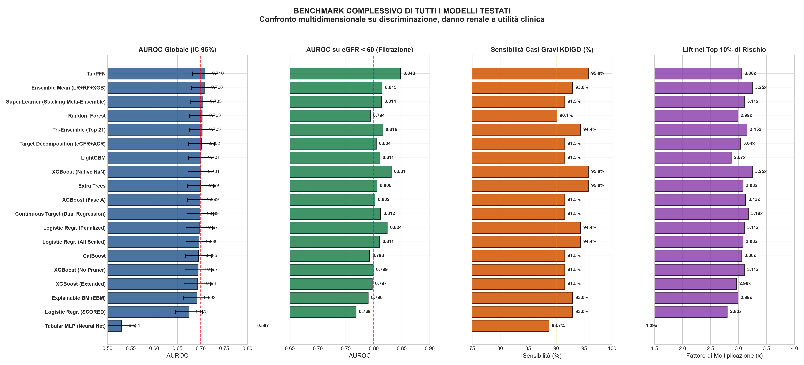
</p>

### Platform Architecture & Features:
1. **Guided 10-Step Navigation:**
   - `00 Scope`: clinical rationale, target definitions, and system positioning.
   - `01 Cohort`: KDIGO distribution heatmap, anti-leakage filters, MissForest benchmark.
   - `02 Phase A`: primary models, interactive vector ROC/PR curves, and SHAP attributions.
   - `03 Phase B`: rebalancing audit table and empirical demystification of the 0.5 cutoff.
   - `04 Phase D`: information bottleneck diagnostics, TabPFN, and positive controls.
   - `05 Non Sup. & AI`: continuous AI threshold dynamics, unsupervised split comparisons.
   - `06 NHANES & Mortality`: zero-shot US validation, sarcopenia confutation, and Cox survival curves.
   - `07 Lockbox & DCA`: real-time interactive decision curve slider, calculating tests spared and cost reduction.
   - `08 Scientific Atlas`: searchable, category-filtered gallery cataloging all **82 high-resolution thesis figures**, expandable via full-screen lightbox modal.
   - `09 Results & Thesis`: executive summary, interactive walkthrough, and state-of-the-art matrix.
2. **Zero-Dependency Architecture:**
   Built purely with Vanilla JavaScript ES6+, native CSS Grid, and dynamic SVG rendering. Zero runtime bundle dependencies, loading in <200 ms.
3. **Dynamic Real-Time Internationalization (IT / EN):**
   Instant language switching with complete, professionally translated text across all views, tables, and tooltips.
4. **Responsive Neo-Grotesque Aesthetic:**
   Adaptive dark/light theme, tested on 4K workstation monitors, standard laptops, and mobile touchscreens.

---

## ⚙️ Reproducibility & Execution Guide

All experiments are governed by a single configuration file ([`configs/config.yaml`](configs/config.yaml)), with random seed strictly fixed at `42`.

### 1. Environment Setup

```bash
# 1. Clone the repository
git clone https://github.com/KekkoCoppola/K-Risk.git
cd K-Risk

# 2. Create and activate a clean virtual environment
python -m venv .venv

# On Linux / macOS:
source .venv/bin/activate
# On Windows PowerShell:
.venv\Scripts\activate

# 3. Install pinned dependencies
pip install -r requirements-lock.txt
```

### 2. Execution Pipeline

Execute pipeline components in strict deterministic order:

```bash
# Run complete automated unit and regression test suite
python -m pytest

# Data preprocessing and stratified splitting
python -m src.data.split                      # Generate stratified train and test cohorts
python -m src.data.imputation                 # Imputation benchmark evaluation
python -m src.data.imputed                    # Cache imputed fold partitions using MissForest

# Phase A Modeling (Primary Classifiers in Nested CV)
python -m src.models.phase_a                  # Fit models with Optuna Bayesian hyperparameter search
python -m src.models.evaluation               # Compute out-of-fold metrics and calibration
python -m src.models.interpretation           # Extract Odds Ratios and SHAP values

# Phase B Modeling (Rebalancing Strategies)
python -m src.data.augmented                  # Synthesize balanced training partitions per fold
python -m src.models.phase_b                  # Train models with weights, SMOTE-NC, and CTGAN
python -m src.models.evaluation_b             # Audit apparent vs real threshold operating points

# Advanced Modules (Phases C, D, Clinical Utility & Presentation)
python -m src.models.phase_c                  # Diabetic subgroup evaluation
python -m src.models.phase_d --evaluate       # Information ceiling diagnostics and TabPFN
python -m src.models.clinical_utility         # Decision Curve Analysis and economic modeling
python -m src.analytics.presentation_charts   # Generate all high-resolution figures in analytics/
```

---

## 🗂️ Repository Directory Structure

```
MetaRisk/
├── .claude/                   AI research agents and assistant configurations
├── analisi_impatto/           In-depth scientific analyses, audits, and NHANES validation
│   ├── 01_audit_dati.md       Cohort data audit and distribution checks
│   ├── 04_esperimenti/        Numerical result tables for unsupervised AI and NHANES transfer
│   ├── decisioni.md           Chronological log of all methodological decisions
│   └── pagina_relatori/       Executive summary document for the thesis committee
├── analytics/                 All 82 scientific figures and performance tables
│   ├── dataset/               Cohort descriptive exploration and KDIGO target distributions
│   ├── split/                 Stratification validation and standardized mean difference (SMD)
│   ├── preprocessing/         Feature maps, univariate AUC, and MissForest benchmark
│   ├── phase_a/               Out-of-fold metrics, calibration, and SHAP beeswarm plots
│   ├── phase_b/               Rebalancing audits and threshold shift distortion charts
│   ├── phase_c/               Diabetic subgroup analysis figures
│   ├── phase_d/               Information ceiling diagnostics, positive controls, advanced models
│   ├── presentation/          High-resolution summary figures for presentation and defense
│   ├── quality/               Decision Curve Analysis, net benefit, and cost curves
│   ├── soglia_ai/             Unsupervised AI, continuous threshold, NHANES, and mortality figures
│   └── test/                  Official test lockbox evaluation reports and checksums
├── configs/
│   └── config.yaml            Single source of truth: paths, seed 42, thresholds, feature sets
├── data/
│   ├── raw/                   Original immutable dataset certified with hash (CC BY 4.0)
│   ├── processed/             Derived training and test sets (unversioned)
│   └── augmented/             Cache of balanced synthetic training folds
├── docs/                      Static web platform for GitHub Pages and academic sources
│   ├── analytics/             All 82 figures synchronized for the web dashboard
│   ├── charts/                Vector graphics and committee summary composite figure
│   ├── thesis/                Complete LaTeX sources for the thesis (main.tex, bib.bib)
│   ├── app.js / app.css       Interactive SPA application engine and styles
│   ├── data.js / i18n.js      Client-side scientific database and bilingual localization
│   └── index.html             Complete K-Risk scientific web dashboard
├── models/                    Serialized weights and checkpoints for fitted models
├── papers/                    Reference clinical and methodology literature (KDIGO, TRIPOD)
├── src/                       Modular Python source code for the research pipeline
│   ├── config.py              Global YAML configuration parser
│   ├── data/                  Data loading, preprocessing, stratified splitting, MissForest
│   ├── models/                Model architectures, nested CV, evaluation, and lockbox verification
│   └── analytics/             Automated chart and report generation scripts
├── tests/                     Unit and integration test suite (pytest)
├── CITATION.cff               Software and research thesis citation metadata
├── LICENSE                    Open-source MIT License
├── Notepad.md                 Detailed chronological log of methodological milestones
├── README.md                  Full documentation in Italian
├── README_EN.md               Full documentation in English
└── valorizzazione_tesi.md     Scientific positioning and contextualization document
```

---

## ⚠️ Declared Limitations & Ethical Considerations

In accordance with international reporting guidelines for healthcare prediction models (**TRIPOD+AI**):

1. **Cross-Sectional Data & Single-Timepoint Measurement:** The formal KDIGO definition of chronic kidney disease requires persistent laboratory abnormalities for **at least 3 months**. With access to a single cross-sectional measurement per individual, the model identifies **current markers of renal impairment**, rather than confirmed chronicity. Transitory acute kidney injury (AKI) cannot be fully ruled out without follow-up re-testing.
2. **Specific Derivation Setting:** The primary development cohort stems from a rural community-based survey in Yunnan, China, featuring young-to-middle-aged adults. Although zero-shot validation on NHANES demonstrated outstanding cross-population generalizability, implementation within specific local health systems should be preceded by local baseline calibration.
3. **Biological Boundary of Circulating Albuminuria:** Early glomerular damage predominantly manifests as microalbumin leakage in urine, which does not produce macroscopic circulating biomarker perturbations in blood until advanced structural decline occurs.
4. **Usage Statement:** **K-Risk is an academic and methodological research software project.** It does not constitute a certified medical device (*Medical Device Software* under EU MDR 2017/745 or FDA guidelines), carries no CE/FDA clearance, and is not designed to issue autonomous clinical diagnoses or prescribe therapeutic changes without the direct, irreplaceable evaluation of a licensed physician.

---

## 📖 Citation & License

If you utilize the code, methodology, or scientific findings of this project in academic research, thesis work, or publications, please cite this repository and the underlying data source.

### BibTeX Citation:

```bibtex
@mastersthesis{coppola2027krisk,
  author       = {Francesco Coppola},
  title        = {{Clinical and Metabolic Profiles for Detecting Occult Renal Damage: Machine Learning Models and KDIGO Stratification}},
  school       = {University of Salerno, Department of Computer Science},
  year         = {2027},
  month        = {March},
  type         = {B.Sc. Thesis in Computer Science},
  note         = {Supervisors: Dr. Fabiola De Marco, Dr. Domenico Rossi. Software repository: https://github.com/KekkoCoppola/K-Risk}
}
```

### Primary Clinical & Dataset References:
- **Jinuo Dataset:** Li, J. et al. *A bimodal dataset for diabetes research.* Scientific Data **13**, 6923 (2026). [doi:10.1038/s41597-026-06923-y](https://doi.org/10.1038/s41597-026-06923-y)
- **NHANES Cohort:** Centers for Disease Control and Prevention (CDC). *National Health and Nutrition Examination Survey Data (2005–2018).* Hyattsville, MD: U.S. Department of Health and Human Services, CDC.
- **KDIGO Guidelines:** Kidney Disease: Improving Global Outcomes (KDIGO) CKD Work Group. *KDIGO 2024 Clinical Practice Guideline for the Evaluation and Management of Chronic Kidney Disease.* Kidney Int **105**(4S), S117–S314 (2024). [doi:10.1016/j.kint.2023.10.018](https://doi.org/10.1016/j.kint.2023.10.018)
- **2021 CKD-EPI Equation:** Inker, L. A. et al. *New Creatinine- and Cystatin C–Based Equations to Estimate GFR without Race.* N Engl J Med **385**(19), 1737–1749 (2021). [doi:10.1056/NEJMoa2102953](https://doi.org/10.1056/NEJMoa2102953)
- **Decision Curve Analysis:** Vickers, A. J. et al. *Decision curve analysis: a novel method for evaluating prediction models.* BMJ **353**, i2216 (2016). [doi:10.1136/bmj.i2216](https://doi.org/10.1136/bmj.i2216)

### Open-Source Licenses
- **Source Code:** [MIT License](LICENSE) © 2026 Francesco Coppola.
- **Raw Data:** [Creative Commons Attribution 4.0 International (CC BY 4.0)](https://creativecommons.org/licenses/by/4.0/), owned by original authors (*Li et al.*).

---

<div align="center">

**Francesco Coppola**  
*Department of Computer Science · University of Salerno*  
ORCID: [0009-0009-0758-8226](https://orcid.org/0009-0009-0758-8226) · GitHub: [@KekkoCoppola](https://github.com/KekkoCoppola)

</div>
